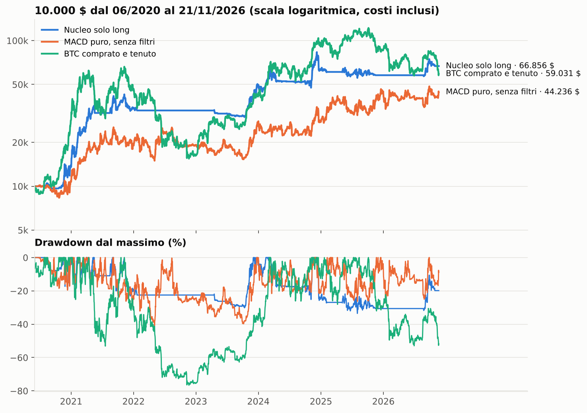

# Algoritmo "MACD a regime" · costruito sui dati

Hai chiesto di costruire io la regola, senza le tue risposte. L'ho ricavata dai dati: tutti i segnali MACD settimanali di 165
monete, le condizioni che separano i trade buoni dai cattivi, poi una regola completa testata come portafoglio.
Data: 22/11/2026. Seguito di [`SWING.md`](SWING.md).

> Ricerca su dati storici, non una raccomandazione d'investimento.

## 1. Sintesi

**L'algoritmo è il tuo MACD settimanale con due filtri di trend, uno stop e un trailing. Nello storico rende il 34% annuo con
drawdown −33,5% e leva 1x. Non raggiunge il 70% di operazioni vincenti (44%) e dal 2024 rende l'11% annuo.**

| | Risultato dal 06/2020 al 21/11/2026 |
|---|---|
| 10.000 $ diventano | 66.856 $ |
| Rendimento annuo | +34,1% |
| Max drawdown | −33,5% (entro il tuo limite di −35%) |
| Operazioni | 82, circa 13 l'anno; vincenti 44% |
| Vincita media / perdita media | +102% / −16% |
| 2020–23 e 2024–26 | +55% annuo e +11% annuo |
| Stesso risultato su due metà separate delle monete | sì: +40% e +33% annuo, drawdown −28% e −34% |
| Stato oggi | nessuna posizione: BTC è sotto la media a 40 settimane |

Tre cose da sapere prima di usarlo:

1. **Il 70% di vincenti non è compatibile con questa regola.** Guadagna perché le vincite sono sei volte le perdite, non
   perché vince spesso. I cinque trade migliori fanno il 73% del guadagno.
2. **È fermo da due anni.** Il massimo è di dicembre 2024; da allora il capitale è sceso fino a −33,5% (è il drawdown
   massimo di tutto lo storico) e oggi è a −20%: i rialzi delle altcoin sono stati brevi.
3. **Gli short non aggiungono rendimento.** La gamba short da sola fa +1,2% annuo. Il nucleo consigliato è solo long; quando
   il mercato è ribassista sta in liquidità.

Rispetto a W3 del repo radar su BTC (42% annuo, drawdown −21%) è peggiore da solo, ma i due insieme, metà e metà, danno il
39% annuo con drawdown −21%: è la combinazione migliore misurata finora.



## 2. Le regole

Si guarda la candela settimanale chiusa la domenica alle 00:00 UTC e si opera il lunedì.

| | Regola |
|---|---|
| **Regime** | BTC chiude la settimana sopra la sua media semplice a 40 settimane. Se è sotto: nessun nuovo acquisto. |
| **Monete** | Le 30 con più controvalore scambiato (mediana a 60 giorni), con almeno 40 settimane di storia. La lista si aggiorna ogni settimana. |
| **Ingresso long** | Il MACD (12, 26, 9) settimanale della moneta incrocia al rialzo la linea di segnale **e** la moneta chiude sopra la sua media a 40 settimane. Acquisto spot il lunedì. |
| **Stop** | Chiusura giornaliera a −20% dall'ingresso: si esce. |
| **Trailing** | Chiusura giornaliera a −30% dalla chiusura più alta raggiunta dopo l'ingresso: si esce. |
| **Uscita di segnale** | Il MACD settimanale incrocia al ribasso: si esce il lunedì. |
| **Dimensione** | Ogni posizione vale il 10% del capitale (rischio del 2% allo stop). Massimo 10 posizioni, nessuna leva. |
| **Tetto** | Una posizione che supera il 20% del capitale viene alleggerita al 15%. |
| **Precedenza** | Se i segnali sono più dei posti liberi, entrano le monete più liquide. |

Costi nel test: 0,20% per lato sullo spot. Dati Binance (TAO da Bitget) fino al 21/11/2026.

## 3. Da dove nascono i due filtri

Ho preso tutti gli incroci del MACD settimanale senza filtri e li ho divisi per le condizioni presenti all'ingresso.

2381 trade chiusi su 165 monete (incrocio MACD settimanale senza filtri, costi inclusi).

| Condizione all'ingresso | Trade | Guadagno medio | Mediano | Vincenti | Medio 2020–23 | Medio 2024–26 |
|---|---|---|---|---|---|---|
| Long, tutti | 1191 | +23,5% | -17,3% | 31% | +49,6% | -11,3% |
| Long con BTC sopra la media a 40 settimane | 869 | +40,1% | -13,8% | 36% | +84,6% | -8,8% |
| Long con BTC sotto | 322 | -21,2% | -34,8% | 17% | -20,9% | -21,8% |
| Long con moneta sopra la sua media a 40 settimane | 415 | +73,6% | -11,3% | 37% | +103,9% | +5,1% |
| Long con moneta sotto | 776 | -3,3% | -21,6% | 27% | +9,8% | -16,7% |
| **Long con moneta e BTC sopra** | 386 | +79,8% | -11,2% | 38% | +113,5% | +6,1% |
| Short, tutti | 1190 | +4,0% | +4,1% | 52% | -9,3% | +18,7% |
| Short con BTC sotto la media a 40 settimane | 274 | -0,3% | +1,8% | 51% | -3,8% | +9,2% |
| Short con BTC sopra | 916 | +5,3% | +4,4% | 53% | -11,9% | +20,1% |
| Short con moneta sotto la sua media | 770 | +6,4% | +7,0% | 54% | -6,2% | +20,0% |
| Short con moneta sopra | 420 | -0,5% | -3,3% | 49% | -14,7% | +16,1% |
| **Short con moneta e BTC sotto** | 234 | -2,2% | +0,5% | 50% | -7,5% | +10,7% |
| Long con MACD sotto zero (inversione dal basso) | 902 | +8,1% | -21,0% | 28% | +30,3% | -16,5% |
| Short con MACD sopra zero (inversione dall'alto) | 605 | +2,0% | +6,8% | 53% | -15,5% | +20,9% |

- **I long con BTC sotto la media perdono in entrambi i periodi** (−21% e −22% in media). È il long su SOL a 42 $ di agosto
  2022 che tu hai saltato.
- **I long con moneta e BTC sopra la media sono gli unici positivi in entrambi i periodi** (+114% e +6%).
- **Gli short non hanno una condizione stabile**: positivi dal 2024, negativi prima, con qualunque filtro.
- **Comprare l'inversione dal basso (MACD sotto zero) perde dal 2024.** È il contrario di comprare sul supporto.

## 4. Verifiche

Stessa regola, una modifica per volta:

| Versione | 10.000 $ → | CAGR | Max DD | Sharpe | Trade | Vincenti | 2020–23: CAGR / DD | 2024–26: CAGR / DD | Anno peggiore |
|---|---|---|---|---|---|---|---|---|---|
| **Nucleo: solo long, filtri di regime, trailing 30%, tetto 15%, 30 monete più liquide** | 66.856 | +34,1% | -33,5% | 1,07 | 82 | 44% | +55% / -30% | +11% / -34% | -8% |
| con anche gli short (long + short) | 72.447 | +35,8% | -37,0% | 1,06 | 126 | 48% | +59% / -30% | +10% / -37% | -4% |
| solo short | 10.787 | +1,2% | -22,2% | 0,16 | 44 | 55% | +3% / -14% | -1% / -14% | -9% |
| senza trailing e senza tetto | 60.974 | +32,2% | -47,5% | 0,84 | 75 | 44% | +54% / -47% | +8% / -40% | -19% |
| senza filtri di regime (MACD puro, long + short) | 44.236 | +25,8% | -41,1% | 0,73 | 346 | 44% | +32% / -41% | +17% / -27% | -2% |
| solo filtro sulla moneta | 59.959 | +31,9% | -36,3% | 1,01 | 93 | 42% | +51% / -36% | +10% / -34% | -12% |
| solo filtro su BTC | 55.623 | +30,4% | -47,0% | 0,91 | 105 | 41% | +58% / -47% | +1% / -33% | -9% |
| 15 monete più liquide | 77.545 | +37,2% | -27,0% | 1,29 | 61 | 46% | +62% / -24% | +11% / -27% | -8% |
| 60 monete più liquide | 136.892 | +49,8% | -40,4% | 1,25 | 107 | 41% | +81% / -40% | +17% / -37% | -21% |
| trailing 25% | 53.168 | +29,5% | -32,7% | 0,99 | 130 | 47% | +53% / -33% | +4% / -32% | -3% |
| trailing 35% | 75.448 | +36,6% | -37,3% | 1,01 | 126 | 50% | +60% / -34% | +11% / -37% | -7% |
| stop 15% | 42.595 | +25,1% | -36,6% | 0,89 | 77 | 36% | +43% / -37% | +5% / -35% | -14% |
| stop 25% | 61.530 | +32,4% | -31,4% | 1,06 | 89 | 46% | +52% / -28% | +10% / -31% | -5% |
| media a 30 settimane | 59.501 | +31,7% | -29,8% | 1,04 | 80 | 45% | +49% / -27% | +12% / -30% | -6% |
| media a 50 settimane | 54.882 | +30,1% | -36,0% | 0,99 | 82 | 41% | +52% / -35% | +6% / -36% | -11% |
| metà A delle monete (ordine alfabetico, posti dispari) | 90.455 | +40,5% | -27,7% | 1,20 | 80 | 48% | +60% / -28% | +18% / -28% | -9% |
| metà B delle monete (posti pari) | 63.907 | +33,2% | -33,6% | 0,99 | 77 | 38% | +55% / -34% | +9% / -27% | -12% |

- **I filtri contano**: senza, il rendimento scende dal 34% al 26% annuo con il quadruplo delle operazioni.
- **Trailing e tetto riducono il drawdown** da −47% a −33% senza togliere rendimento.
- **I parametri vicini danno risultati simili**: fra il 25% e il 37% annuo con stop, trailing e media diversi. Con 15 monete
  il drawdown scende a −27%; con 60 il rendimento sale al 50% ma con monete meno liquide.
- **Due metà separate delle monete danno lo stesso quadro.** I filtri sono stati scelti guardando tutte le monete, quindi
  non è una prova fuori campione completa, ma esclude che il risultato dipenda da poche monete.

Anno per anno:

| | 2020 | 2021 | 2022 | 2023 | 2024 | 2025 | 2026 |
|---|---|---|---|---|---|---|---|
| Nucleo solo long | +37% | +150% | -4% | +45% | +31% | -8% | +16% |
| MACD puro, senza filtri | +7% | +83% | -2% | +39% | +3% | +62% | -1% |
| BTC comprato e tenuto | +184% | +60% | -64% | +156% | +121% | -6% | -31% |

I trade:

| Gruppo | Trade | Vincenti | Guadagno medio | Mediano | Vincita media | Perdita media | Migliore | Peggiore | Giorni medi |
|---|---|---|---|---|---|---|---|---|---|
| Tutti | 82 | 44% | +36,1% | -3,9% | +102,5% | -16,0% | +780% | -26% | 60 |
| Long | 82 | 44% | +36,1% | -3,9% | +102,5% | -16,0% | +780% | -26% | 60 |
| Usciti per segnale MACD | 31 | 45% | +19,1% | -2,6% | +55,8% | -11,1% | +326% | -20% | 78 |
| Usciti per trailing | 30 | 70% | +93,7% | +36,0% | +138,0% | -9,8% | +780% | -19% | 68 |
| Usciti per stop | 20 | 0% | -22,8% | -22,4% | n/d | -22,8% | -21% | -26% | 24 |

I 5 trade migliori (ADA +780%, ETH +436%, RNDR +360%, BTC +326%, SOL +251%) valgono il 73% della somma dei guadagni per trade.

Le operazioni chiuse dal trailing sono le migliori (70% vincenti, +94% medio): è la risposta dei dati a "quando vendere".

## 5. Rischio e leva

| Rischio per trade / esposizione massima | 10.000 $ → | CAGR | Max DD | Sharpe | Trade | Vincenti | 2020–23: CAGR / DD | 2024–26: CAGR / DD | Anno peggiore |
|---|---|---|---|---|---|---|---|---|---|
| 1% / 0,5x | 23.909 | +14,4% | -19,5% | 0,93 | 82 | 43% | +21% / -16% | +6% / -20% | -4% |
| 1,5% / 0,75x | 42.436 | +25,0% | -27,0% | 1,03 | 82 | 44% | +39% / -24% | +9% / -27% | -6% |
| 2% / 1x | 66.856 | +34,1% | -33,5% | 1,07 | 82 | 44% | +55% / -30% | +11% / -34% | -8% |
| 3% / 1,5x | 124.953 | +47,7% | -43,8% | 1,07 | 86 | 42% | +77% / -42% | +16% / -44% | -12% |
| 4% / 2x | 228.941 | +62,2% | -54,1% | 1,10 | 88 | 43% | +104% / -52% | +20% / -54% | -15% |
| 6% / 3x | 612.694 | +88,9% | -71,1% | 1,17 | 92 | 43% | +138% / -71% | +38% / -65% | -21% |
| 10% / 5x | 845.872 | +98,5% | -94,3% | 1,22 | 94 | 45% | +141% / -94% | +51% / -77% | -28% |

- **Il tuo limite di −35% corrisponde al 2% di rischio per trade senza leva.** Già all'1,5x il drawdown storico è −44%.
- **Il 70% annuo richiede circa 2,5x**, con drawdown intorno a −60%. A 5x il drawdown è −94%.
- Per stare più comodi sotto il limite: rischio 1,5% per trade (25% annuo, drawdown −27%).

Con W3 del repo radar:

| Dal 01/2021 al 10/11/2026 | 10.000 $ → | CAGR | Max DD | Sharpe |
|---|---|---|---|---|
| Nucleo solo long (alt + BTC) | 49.257 | +31,3% | -33,5% | 1,04 |
| W3 radar su BTC, rischio 25% | 78.474 | +42,2% | -21,1% | 1,30 |
| 50% + 50%, ribilanciato ogni giorno | 67.688 | +38,6% | -20,8% | 1,41 |

Correlazione dei rendimenti mensili fra i due: 0,63.

## 6. Su SOL e TAO

Trade che l'algoritmo avrebbe fatto, compresa la gamba short per confronto con le tue operazioni:

**SOL**: trade dell'algoritmo

| Verso | Entra | Esce | Prezzo | Mossa | Uscita |
|---|---|---|---|---|---|
| Long | 2021-08-16 | 2021-09-20 | 54 → 133 | +148% | trailing |
| Long | 2023-10-02 | 2024-01-22 | 24 → 84 | +251% | trailing |
| Long | 2024-10-28 | 2025-01-13 | 177 → 189 | +7% | segnale |
| Long | 2025-01-20 | 2025-02-03 | 252 → 204 | -19% | segnale |
| Long | 2025-05-19 | 2025-06-21 | 173 → 135 | -22% | stop |
| Short | 2026-11-16 | aperto | 73 → 70 | +3% | aperto |

Composto senza costi: x6,1 su 6 trade, vincenti 67%.

**TAO**: trade dell'algoritmo

| Verso | Entra | Esce | Prezzo | Mossa | Uscita |
|---|---|---|---|---|---|
| Long | 2024-09-23 | 2024-11-02 | 469 → 439 | -6% | trailing |
| Long | 2025-10-20 | 2025-11-12 | 439 → 349 | -21% | stop |
| Short | 2025-11-24 | 2026-01-06 | 298 → 294 | +1% | trailing |
| Short | 2026-06-29 | 2026-08-27 | 205 → 254 | -24% | stop |

Composto senza costi: x0,6 su 4 trade, vincenti 25%.

- **Su SOL prende gli stessi tre long che hai fatto tu, con esiti peggiori**: 24 → 84 contro il tuo 20 → 160, 177 → 189
  contro 170 → 200, e il long di maggio 2025 esce in stop a −22% mentre tu hai chiuso a 200. In più fa il long di agosto
  2021 (+148%) che non era fra i tuoi. Non fa i tuoi short del 2021 e del 2025, perché BTC era sopra la media.
- **Su TAO perde**: in quattro trade nessun guadagno vero. TAO si muove in un intervallo, e le regole di trend lì non
  funzionano; è il motivo per cui comprare sul supporto ti ha reso di più.

## 7. Cosa dice oggi

Ultima settimana chiusa: domenica 2026-11-15. BTC ha chiuso a 65.351 $, sotto la media a 40 settimane (72.160 $): regime **ribassista: nessun long ammesso**.

| Posizioni aperte del nucleo (solo long) | Verso | Dal | Ingresso | Ultimo prezzo | Mossa |
|---|---|---|---|---|---|
| nessuna | | | | | |

| Posizioni che aprirebbe la gamba short (non validata) | Dal | Ingresso | Ultimo prezzo | Mossa |
|---|---|---|---|---|
| BTC | 2026-11-16 | 65351 | 60216 | +8% |
| ETH | 2026-11-16 | 1835.3 | 1685.6 | +8% |
| SOL | 2026-11-16 | 72.77 | 70.31 | +3% |
| XRP | 2026-11-16 | 0.9742 | 0.9321 | +4% |
| BNB | 2026-11-16 | 596.79 | 548.61 | +8% |
| DOGE | 2026-11-16 | 0.05987 | 0.0553 | +8% |
| ENA | 2026-11-16 | 0.1214 | 0.0986 | +19% |
| LINK | 2026-11-16 | 9.297 | 8.612 | +7% |
| LTC | 2026-11-16 | 45.57 | 39.81 | +13% |

| Moneta | Chiusura settimanale | Rispetto alla media a 40 settimane | MACD settimanale | Cosa dice l'algoritmo |
|---|---|---|---|---|
| BTC | 65351 | -9% | incrocio al ribasso questa settimana | nessun long (regime ribassista); short ammesso solo nella gamba short |
| ETH | 1835.3 | -14% | incrocio al ribasso questa settimana | nessun long (regime ribassista); short ammesso solo nella gamba short |
| SOL | 72.77 | -17% | incrocio al ribasso questa settimana | nessun long (regime ribassista); short ammesso solo nella gamba short |
| TAO | 194.9 | -20% | sotto il segnale | nessun long (regime ribassista); short ammesso solo nella gamba short |

- **Per TAO**: nessun acquisto. Il prezzo è nella tua zona 150–190, ma moneta e BTC sono sotto la media a 40 settimane. È la
  situazione in cui, nello storico, i long hanno perso in media il 21%.
- **Per rientrare** servono tre cose insieme: BTC sopra 72.160 $ a fine settimana, la moneta sopra la sua media a 40
  settimane e l'incrocio del MACD al rialzo.

## 8. Come usarlo con i tuoi capitali

| Parte | Regola | Con 45.000 $ |
|---|---|---|
| Nucleo spot | l'algoritmo, 10% per posizione, massimo 10 posizioni | 4.500 $ per posizione, perdita allo stop circa 900 $ |
| Leva (2–3 mila $) | stessi segnali, solo sulle 3 monete più liquide, 3x isolato, stop a mercato a −20% | con 2.500 $ a 3x: perdita allo stop circa 1.500 $ |
| W3 su BTC | metà del capitale, se vuoi la combinazione con drawdown più basso | segue il repo radar |
| Fuori regola | acquisti sul supporto come TAO: al massimo una posizione normale (10%), con stop a 126 $ | 4.500 $, non 40–50 mila |

L'ultima riga è il cambiamento più grande rispetto a come hai operato: 40–50 mila $ su una sola moneta sono dieci volte la
dimensione che l'algoritmo assegna a un'operazione.

## 9. Limiti

- **Costruito e testato sugli stessi dati.** I filtri sono stati scelti guardando il 2020–2026; la verifica vera è il
  comportamento da oggi in poi. Consiglio 3–6 mesi su carta, come fa il repo radar.
- **Rendimento concentrato nel 2020–21.** Senza il 2021 (+150%) il rendimento annuo scende molto; dal 2024 è l'11% annuo.
- **Pochi trade grandi.** Cinque operazioni fanno il 73% del guadagno: se ne manchi una, il risultato cambia.
- **Lista di monete scelta da me** (165, con molte poi crollate): distorsione da sopravvivenza ridotta, non eliminata.
- **Esecuzione**: stop e trailing sono calcolati sulla chiusura giornaliera; nei crolli lampo si esce peggio.
- **Tasse non considerate.**
- La gamba short non è validata e non è nel nucleo.

## 10. Riproducibilità

```bash
python backtest/fetch_alts.py alts
```

```bash
python backtest/algo_report.py
```

```bash
python backtest/build_report.py
```

Codice: `backtest/algo.py` (regole e simulatore), `backtest/algo_research.py` (studio dei filtri),
`backtest/algo_report.py` (tabelle e grafico). Risultati in `results/algo/`: `trade_finale.csv` (tutte le operazioni),
`equity_finale.csv`, `trade_macd_tutti.csv` (i 2.381 trade dello studio dei filtri).
