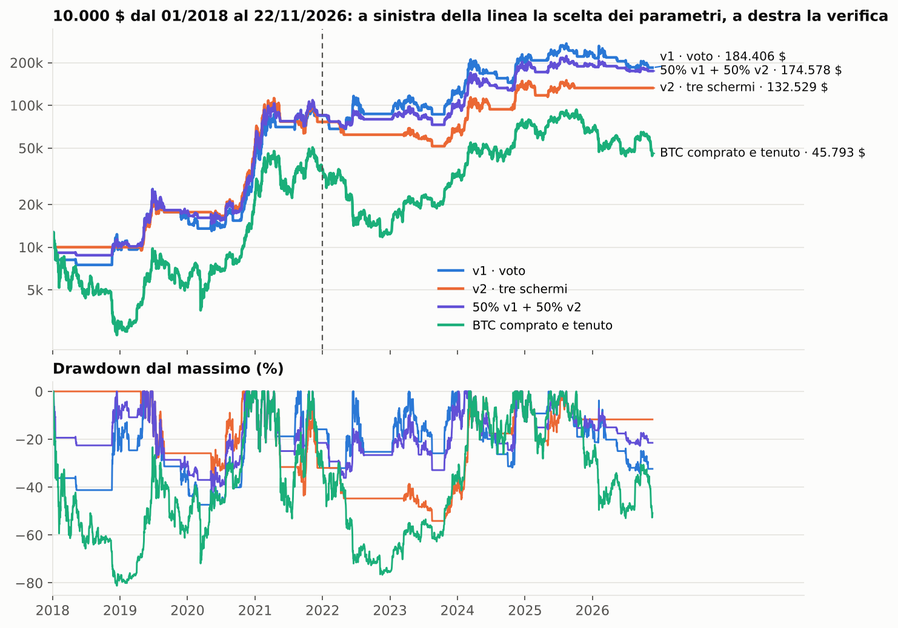

# Analisi tecnica · come funziona, regole verificate e nuovo algoritmo

Ciclo di studio sull'analisi tecnica: come funziona secondo le fonti, quali regole reggono sui dati di BTC dal 2018, un nuovo
algoritmo costruito su quelle basi, il confronto con quello già fatto e la spiegazione di ogni operazione.
Data: 23/11/2026. Seguito di [`ANALISI_BTC.md`](ANALISI_BTC.md).

> Ricerca su dati storici, non una raccomandazione d'investimento.

## 1. Sintesi

**Il nuovo algoritmo a tre schermi (v2) non batte quello a voto (v1); usati insieme, metà e metà, danno il drawdown più
basso nel periodo di verifica. Oggi entrambi sono fuori dal mercato.**

| Dal 01/2018 al 22/11/2026 | v1 · voto di 17 indicatori | v2 · tre schermi (nuovo) | 50% v1 + 50% v2 | BTC tenuto |
|---|---|---|---|---|
| 10.000 $ diventano | 184.406 $ | 132.529 $ | 174.578 $ | 45.793 $ |
| Rendimento annuo | +38,8% | +33,7% | +37,9% | +18,7% |
| Max drawdown | −49,4% | −54,1% | −42,7% | −81,2% |
| Operazioni / vincenti | 30 / 47% | 9 / 56% | 25 / 44% | – |
| 2022–26 (verifica): rendimento annuo / drawdown | +17% / −34% | +12% / −33% | +16% / −26% | +5% / −67% |

Cosa ho imparato in questo ciclo:

1. **Regole confermate su BTC in entrambi i periodi**: le rotture dei massimi a 55 giorni, il volume alto come conferma della
   rottura, l'RSI sopra 70 come segno di forza (non di vendita), gli stop larghi e le uscite a trailing.
2. **Regole smentite o non confermate**: comprare il ritracciamento nel trend, le candele giapponesi, vendere la rottura dei
   minimi, il golden e death cross, la struttura a massimi e minimi crescenti come l'ho codificata.
3. **Scegliere i parametri migliori sul passato non serve**: fra le 126 varianti di v2 la correlazione tra il risultato
   2018–21 e quello 2022–26 è −0,04. Conta la struttura della regola, non il parametro.
4. **Perché long o short** si legge in due modi: in v1 dal voto dei 17 indicatori, in v2 da una frase per ogni operazione
   (capitolo 7).



## 2. Come funziona l'analisi tecnica secondo le fonti

| Tema | Idea | Come si traduce in regola |
|---|---|---|
| **Teoria di Dow** | Il mercato ha tre movimenti: primario (oltre un anno), secondario (almeno tre settimane, spesso un terzo o più del movimento precedente), minore. Un trend resta valido fino a un segnale chiaro di inversione. | Si decide prima la direzione sulla scala lunga; si opera solo in quella direzione. |
| **Struttura** | Trend rialzista = massimi e minimi crescenti; ribassista = decrescenti. Per invertire un rialzo servono un massimo più basso e un minimo più basso. | Si confrontano gli ultimi due massimi e gli ultimi due minimi di swing. |
| **Volume** | Il volume deve crescere nella direzione del trend; una divergenza segnala debolezza. | Una rottura conta di più se avviene con volume sopra la media. |
| **Tre schermi (Elder)** | Schermo 1: trend sulla scala lunga. Schermo 2: oscillatore sulla scala media per trovare il ritracciamento contro il trend. Schermo 3: ingresso su una rottura di breve nella direzione del trend. | Tre controlli in sequenza; se il primo non passa, non si guarda il resto. |
| **Rotture (Turtle)** | Ingresso sulla rottura del massimo a 55 giorni, uscita sulla rottura opposta a 20 giorni, stop a 2 ATR, dimensione proporzionale alla volatilità. | Canale di Donchian per l'ingresso; ATR per stop e dimensione. |
| **Chandelier exit (LeBeau)** | Stop mobile appeso al massimo raggiunto, a distanza di un multiplo dell'ATR. | Uscita quando il prezzo chiude sotto il massimo meno k ATR. |
| **Rischio per operazione** | Si decide prima quanto perdere, poi la quantità: capitale × rischio % ÷ distanza dello stop. | La dimensione dipende dallo stop, non dalla convinzione. |
| **Wyckoff** | Ciclo in quattro fasi: accumulo, rialzo, distribuzione, ribasso. È un quadro interpretativo, senza regole meccaniche standard. | Non codificabile in modo univoco: non l'ho testato. |
| **Candele giapponesi** | Figure di una-tre candele che anticiperebbero inversioni. Gli studi danno risultati misti o nulli dopo i costi. | Testate come eventi (capitolo 3). |

Due avvertenze che le fonti stesse danno: Dow non ha mai scritto un sistema di trading, e non ha definito come distinguere
un'inversione da un ritracciamento; quasi tutto il materiale divulgativo su Elder, Turtle e Wyckoff viene da siti di broker
e da script della comunità, non dai testi originali.

## 3. Le regole messe alla prova su BTC

Per ogni condizione: rendimento medio nei giorni successivi e quota di casi positivi, separati per periodo, da confrontare
con la riga di riferimento.

### 3.1 Trend

| Condizione | Orizzonte | Casi 2018–21 | Rendimento medio / positivi | Casi 2022–26 | Rendimento medio / positivi |
|---|---|---|---|---|---|
| *Tutti i giorni (riferimento)* | 20 g | – | +3,4% / 54% | – | +1,3% / 51% |
| Prezzo sopra la SMA 200 giorni (tutti i giorni) | 20 g | 799 | +3,4% / 53% | 930 | +2,3% / 51% |
| Prezzo sotto la SMA 200 giorni (tutti i giorni) | 20 g | 662 | +3,4% / 55% | 837 | +0,1% / 52% |
| Struttura settimanale rialzista (massimi e minimi di swing) | 20 g | 656 | +2,1% / 49% | 535 | -2,2% / 37% |
| Struttura settimanale mista (massimi e minimi di swing) | 20 g | 546 | +6,1% / 60% | 896 | +1,6% / 53% |
| Struttura settimanale ribassista (massimi e minimi di swing) | 20 g | 259 | +1,1% / 53% | 336 | +5,8% / 69% |
| *Tutti i giorni (riferimento)* | 90 g | – | +20,6% / 53% | – | +7,2% / 54% |
| Golden cross: SMA 50 incrocia sopra la SMA 200 | 90 g | 5 | +11,8% / 60% | 4 | +22,5% / 100% |
| Death cross: SMA 50 incrocia sotto la SMA 200 | 90 g | 4 | +14,6% / 50% | 5 | +18,0% / 60% |

### 3.2 Rotture e volume

| Condizione | Orizzonte | Casi 2018–21 | Rendimento medio / positivi | Casi 2022–26 | Rendimento medio / positivi |
|---|---|---|---|---|---|
| *Tutti i giorni (riferimento)* | 20 g | – | +3,4% / 54% | – | +1,3% / 51% |
| Chiusura sopra il massimo a 55 giorni | 20 g | 52 | +8,0% / 63% | 42 | +3,9% / 57% |
| … con volume oltre 1,5 volte la media a 20 giorni | 20 g | 17 | +10,8% / 71% | 26 | +5,6% / 69% |
| … con volume normale o basso | 20 g | 38 | +6,1% / 61% | 22 | +2,3% / 41% |
| … con prezzo sopra la SMA 200 | 20 g | 47 | +8,9% / 64% | 38 | +4,9% / 61% |
| Chiusura sotto il minimo a 55 giorni | 20 g | 16 | -1,6% / 44% | 23 | +1,4% / 52% |

### 3.3 Oscillatori

| Condizione | Orizzonte | Casi 2018–21 | Rendimento medio / positivi | Casi 2022–26 | Rendimento medio / positivi |
|---|---|---|---|---|---|
| *Tutti i giorni (riferimento)* | 20 g | – | +3,4% / 54% | – | +1,3% / 51% |
| RSI giornaliero scende sotto 30 | 20 g | 14 | +3,2% / 50% | 20 | +4,9% / 60% |
| … con prezzo sopra la SMA 200 | 20 g | 2 | -9,7% / 0% | 3 | +11,6% / 67% |
| … con prezzo sotto la SMA 200 | 20 g | 14 | +3,9% / 50% | 17 | +3,7% / 59% |
| RSI giornaliero sale sopra 70 | 20 g | 41 | +8,8% / 68% | 35 | +5,4% / 66% |
| … con prezzo sopra la SMA 200 | 20 g | 34 | +10,1% / 68% | 33 | +6,5% / 70% |
| Ritracciamento in trend rialzista: RSI sotto 45, poi chiusura sopra il massimo del giorno prima | 20 g | 52 | -2,7% / 48% | 69 | -0,1% / 43% |

### 3.4 Scale temporali

| Condizione | Orizzonte | Casi 2018–21 | Rendimento medio / positivi | Casi 2022–26 | Rendimento medio / positivi |
|---|---|---|---|---|---|
| *Tutti i giorni (riferimento)* | 20 g | – | +3,4% / 54% | – | +1,3% / 51% |
| MACD giornaliero incrocia al rialzo, tutti i casi | 20 g | 50 | +4,1% / 50% | 67 | +2,9% / 52% |
| … con chiusura settimanale sopra la SMA 40 settimane | 20 g | 27 | +2,9% / 41% | 39 | +1,9% / 46% |
| … con chiusura settimanale sotto la SMA 40 settimane | 20 g | 23 | +5,5% / 61% | 28 | +4,3% / 61% |

### 3.5 Candele giapponesi

| Condizione | Orizzonte | Casi 2018–21 | Rendimento medio / positivi | Casi 2022–26 | Rendimento medio / positivi |
|---|---|---|---|---|---|
| *Tutti i giorni (riferimento)* | 5 g | – | +0,8% / 54% | – | +0,3% / 51% |
| Engulfing rialzista | 5 g | 134 | +1,2% / 51% | 174 | -0,1% / 45% |
| Engulfing ribassista | 5 g | 121 | +0,1% / 54% | 170 | +0,2% / 51% |
| Hammer dopo un calo | 5 g | 41 | -0,7% / 56% | 38 | +0,8% / 63% |
| Shooting star dopo un rialzo | 5 g | 22 | -0,4% / 45% | 26 | +1,0% / 50% |
| Doji | 5 g | 162 | -0,5% / 50% | 215 | +0,1% / 52% |

### 3.6 Verdetti

| Regola classica | Verdetto su BTC 2018–2026 | Evidenza |
|---|---|---|
| Le rotture dei massimi segnano continuazione | **confermata** | dopo una chiusura sopra il massimo a 55 giorni: +8,0% e +3,9% a 20 giorni, contro +3,4% e +1,3% di riferimento |
| Il volume conferma la rottura | **confermata**, su pochi casi | con volume alto +10,8% e +5,6%; con volume normale +6,1% e +2,3% |
| Ipercomprato = vendere | **smentita** | dopo un RSI sopra 70: +8,8% e +5,4%. È un segno di forza |
| Lascia correre i profitti, taglia le perdite | **confermata** | vincita media +51% contro perdita media −9% in v1; le uscite a trailing sono le migliori nello studio sulle altcoin |
| Stop larghi invece che stretti | **confermata** | con chandelier a 3 ATR il rendimento mediano 2018–21 è −8% annuo; a 4–5 ATR è +12% e +22% |
| Opera nella direzione del trend primario | **confermata in parte** | sopra la SMA 200 il rendimento a 20 giorni è migliore solo nel 2022–26; come filtro riduce i drawdown in entrambi i periodi e sulle altcoin è decisivo |
| Ipervenduto = comprare | **debole** | dopo un RSI sotto 30: in media nel 2018–21, meglio della media nel 2022–26, su 14 e 20 casi |
| Massimi e minimi crescenti = trend rialzista | **non confermata** come l'ho codificata | con struttura settimanale "rialzista" i 20 giorni successivi rendono meno della media: la conferma arriva tardi |
| Golden cross e death cross | **non verificabile** | 9 casi per tipo; dopo i death cross il prezzo è salito in media del 15–18% in 90 giorni |
| Vendi la rottura dei minimi | **non confermata** | dopo una chiusura sotto il minimo a 55 giorni: −1,6% e +1,4% |
| Compra il ritracciamento nel trend (secondo schermo di Elder) | **smentita** | −2,7% e −0,1% a 20 giorni, sotto il riferimento |
| Allinea le scale temporali | **non confermata** per il MACD | l'incrocio giornaliero rende di più con la scala settimanale contraria |
| Candele giapponesi | **nessun valore** | tutte le figure entro un punto dal riferimento, con segno che cambia fra i periodi |
| Sentiment estremo al contrario | **smentita** | paura estrema seguita da rendimenti pari o inferiori alla media (`ANALISI_BTC.md`) |
| Compra sul supporto testato | **non confermata** | su 165 altcoin, 44% di successi contro 45% con ingressi casuali (`SWING.md`) |

## 4. Regole per l'analisi tecnica

Regole operative che escono dalle fonti e che i dati di BTC non smentiscono. Sono regole di metodo, non una garanzia di
risultato.

**Lettura del mercato**

1. **Parti dalla scala settimanale.** Chiusura sopra o sotto la media a 40 settimane: decide se cerchi long o stai fermo.
2. **Non comprare con il prezzo sotto la media a 40 settimane.** Sulle altcoin vale anche per BTC: con BTC sotto la sua
   media, i long hanno perso in media il 21%.
3. **Un indicatore solo non basta.** Nessuno dei 20 testati regge da solo come long/short; usa il consenso di più famiglie
   (trend, momentum, rottura, volume).
4. **Leggi gli oscillatori nel verso del trend.** RSI sopra 70 in un rialzo è forza, non un segnale di vendita.
5. **Ignora le singole candele e i livelli di sentiment** come segnali operativi: descrivono, non anticipano.

**Ingresso**

6. **Entra sulla rottura, non sul ritracciamento.** Chiusura sopra il massimo a 55 giorni, nel verso della scala lunga.
7. **Chiedi conferma al volume.** Una rottura con volume oltre una volta e mezza la media a 20 giorni vale di più.
8. **Short solo con consenso quasi totale.** Su BTC gli short hanno reso poco o nulla; servono tutti gli indicatori d'accordo,
   e anche così il vantaggio non è dimostrato.

**Uscita e rischio**

9. **Stop largo, definito all'ingresso**: 4–5 ATR giornalieri. Gli stop stretti peggiorano il risultato.
10. **Esci con un trailing, non con un target.** Lo stop segue il massimo raggiunto; i pochi trade grandi fanno il risultato.
11. **Decidi la perdita prima della quantità.** Quantità = capitale × rischio % ÷ distanza dello stop.
12. **Niente leva oltre 1,5–2x.** Oltre, il rendimento composto scende; per restare entro −35% di drawdown serve stare sotto 1x.

**Metodo**

13. **Aspettati meno del 50% di operazioni vincenti.** Le regole di trend guadagnano con vincite molte volte più grandi
    delle perdite. Un 70% di vincenti si ottiene solo con target vicini e stop lontani, e nei test perde.
14. **Verifica ogni regola su dati non usati per sceglierla**, e non fidarti del parametro migliore: fra le 126 varianti
    di v2, il risultato del primo periodo non dice nulla sul secondo.
15. **Scrivi il motivo di ogni operazione** prima di aprirla. Se non riesci a scriverlo in una frase, non è un segnale.

## 5. Il nuovo algoritmo: v2 a tre schermi

| Schermo | Regola |
|---|---|
| **1 · Marea** (settimanale) | Rialzista se la chiusura settimanale è sopra la media a 40 settimane e la struttura dei massimi e minimi di swing non è ribassista. Ribassista se la chiusura è sotto la media, la media scende da 4 settimane e la struttura è ribassista. Altrimenti neutra: nessuna operazione. |
| **2 · Onda** (giornaliero) | Con marea rialzista: chiusura sopra il massimo dei 55 giorni precedenti. Con marea ribassista: chiusura sotto il minimo a 55 giorni. |
| **3 · Rischio** | Stop iniziale a 5 ATR(22) dall'ingresso. Uscita chandelier: chiusura sotto la chiusura più alta dall'ingresso meno 5 ATR. |
| Esecuzione | Decisione alla chiusura giornaliera, long in spot, short in perp, 1x, costi 0,10% per lato. |

Griglia di 126 combinazioni valutata sul 2018–21. Scelta (miglior rapporto rendimento/drawdown fra quelle con gli short ammessi): ingresso per **rottura**, chandelier a **5 ATR**, uscita sul cambio di marea **no**, short in versione **severa**.

| Scelta di progetto | Rendimento annuo mediano 2018–21 | DD mediano | Rendimento annuo mediano 2022–26 | DD mediano | Vincenti | Operazioni |
|---|---|---|---|---|---|---|
| Ingresso: entrambi | +5% | -65% | +14% | -43% | 35% | 36 |
| Ingresso: ritracciamento | +5% | -69% | +12% | -46% | 36% | 32 |
| Ingresso: rottura | +42% | -45% | +13% | -25% | 45% | 14 |
| Short: no | +14% | -64% | +15% | -40% | 39% | 24 |
| Short: severa | +19% | -63% | +6% | -50% | 35% | 31 |
| Short: simmetrica | -1% | -76% | +18% | -43% | 35% | 40 |
| Uscita sul cambio di marea: no | +12% | -64% | +11% | -43% | 35% | 30 |
| Uscita sul cambio di marea: sì | +7% | -64% | +15% | -44% | 39% | 33 |
| Chandelier, ATR: 3 | -8% | -77% | +11% | -45% | 32% | 47 |
| Chandelier, ATR: 4 | +12% | -64% | +17% | -39% | 42% | 30 |
| Chandelier, ATR: 5 | +22% | -62% | +12% | -46% | 37% | 23 |

Correlazione fra il risultato 2018–21 e quello 2022–26 delle 126 combinazioni (indice di Sharpe): -0,04. Combinazioni in guadagno nel 2022–26: 90%.

Cosa dice la griglia:

- **L'ingresso su rottura batte quello su ritracciamento** nel 2018–21 (+42% contro +5% mediano) e ha il drawdown più basso
  in entrambi i periodi. Coincide con il verdetto del capitolo 3.
- **Gli short non migliorano**: nella variante scelta la versione severa non scatta mai; nelle altre fa pochi short e
  peggiora il periodo di verifica; quella simmetrica perde nel 2018–21. v2 è di fatto un algoritmo solo long.
- **Lo stop a 3 ATR è il peggiore.**

## 6. Confronto con quanto già fatto

| Strategia | 10.000 $ → (2018–2026) | CAGR | Max DD | Sharpe | Operazioni | Vincenti | Vincita / perdita media | 2018–21: CAGR / DD | 2022–26: CAGR / DD | Dal 2021: CAGR / DD | Tempo a mercato |
|---|---|---|---|---|---|---|---|---|---|---|---|
| v1 · voto di 17 indicatori, long/short | 184.406 | +38,8% | -49,4% | 0,95 | 30 | 47% | +51% / -9% | +70% / -49% | +17% / -34% | +30% / -34% | 54% |
| v1 · voto, solo long | 190.653 | +39,3% | -41,2% | 1,04 | 23 | 48% | +60% / -7% | +68% / -41% | +19% / -32% | +32% / -32% | 42% |
| v2 · tre schermi (nuovo) | 132.529 | +33,7% | -54,1% | 0,96 | 9 | 56% | +107% / -9% | +66% / -44% | +12% / -33% | +17% / -54% | 40% |
| 50% v1 + 50% v2 | 174.578 | +37,9% | -42,7% | 1,03 | 25 | 44% | +59% / -5% | +71% / -43% | +16% / -26% | +25% / -36% | 60% |
| Prezzo vs SMA 40 settimane, solo long | 72.802 | +25,0% | -62,4% | 0,70 | 13 | 54% | +75% / -14% | +24% / -62% | +26% / -38% | +27% / -54% | 62% |
| BTC comprato e tenuto | 45.793 | +18,7% | -81,2% | 0,59 | 1 | 100% | +346% / n/d | +37% / -81% | +5% / -67% | +17% / -77% | 100% |
| W3 del repo radar, rischio 25% (dati dal 2021) | – | – | – | 1,30 | 13 | 92% | – | – | – | +42% / −21% | 61% |

v1 e v2 hanno la stessa posizione nel 74% dei giorni; correlazione dei rendimenti mensili 0,79.

Anno per anno:

| | 2018 | 2019 | 2020 | 2021 | 2022 | 2023 | 2024 | 2025 | 2026 |
|---|---|---|---|---|---|---|---|---|---|
| v1 · voto di 17 indicatori, long/short | +3% | +61% | +136% | +115% | +3% | +40% | +65% | +16% | -21% |
| v1 · voto, solo long | -25% | +83% | +172% | +115% | +0% | +40% | +65% | +10% | -7% |
| v2 · tre schermi (nuovo) | +0% | +77% | +189% | +50% | -19% | +6% | +99% | +1% | +0% |
| 50% v1 + 50% v2 | +4% | +70% | +163% | +82% | -6% | +23% | +82% | +9% | -10% |
| BTC comprato e tenuto | -72% | +94% | +302% | +60% | -64% | +156% | +121% | -6% | -30% |

Lettura:

1. **v1 resta il migliore fra i due** per rendimento e per risultato nel periodo di verifica. v2 fa poche operazioni (9 in
   nove anni), con più vincenti (56%) ma un drawdown più profondo, perché tiene le posizioni con uno stop molto largo.
2. **I due sbagliano in momenti diversi**: v1 ha sofferto nel 2026 (−21%), v2 nel 2022 (−19%). Insieme, metà e metà, il
   drawdown nel periodo di verifica scende a −26%.
3. **Nessuno dei due raggiunge W3 del repo radar** dal 2021 (+42% annuo, drawdown −21%, 92% di vincenti). W3 usa il flusso
   sul perp oltre al prezzo: è l'informazione in più che fa la differenza su BTC.
4. **Tutti battono il comprare e tenere** soprattutto perché evitano i ribassi del 2018, 2022 e 2026.

## 7. Perché long o short

### 7.1 Tutte le operazioni di v2, con il motivo

| # | Verso | Entra | Esce | Prezzo | Risultato | Perché entra | Perché esce |
|---|---|---|---|---|---|---|---|
| 1 | long | 2019-04-23 | 2019-08-28 | 5.493 → 9.721 | +77% | marea rialzista: chiusura settimanale 5.256 sopra la SMA 40 (5.184), struttura mista (massimi 4.198→4.198, minimi 3.156→3.350); rottura: chiusura 5.493 sopra il massimo a 55 giorni (5.422); stop iniziale 4.638 | chandelier: chiusura 9.721 oltre lo stop 9.999 (5 ATR dalla miglior chiusura 13.094) |
| 2 | long | 2020-05-07 | 2021-05-17 | 9.986 → 43.538 | +336% | marea rialzista: chiusura settimanale 8.894 sopra la SMA 40 (8.476), struttura mista (massimi 10.370→10.500, minimi 6.435→3.782); rottura: chiusura 9.986 sopra il massimo a 55 giorni (9.460); stop iniziale 7.570 | chandelier: chiusura 43.538 oltre lo stop 44.159 (5 ATR dalla miglior chiusura 63.575) |
| 3 | long | 2021-08-20 | 2021-12-04 | 49.322 → 49.152 | -0% | marea rialzista: chiusura settimanale 46.974 sopra la SMA 40 (39.839), struttura mista (massimi 59.500→41.330, minimi 28.805→29.278); rottura: chiusura 49.322 sopra il massimo a 55 giorni (48.144); stop iniziale 37.052 | chandelier: chiusura 49.152 oltre lo stop 50.377 (5 ATR dalla miglior chiusura 67.526) |
| 4 | long | 2022-03-27 | 2022-04-26 | 46.828 → 38.113 | -19% | marea rialzista: chiusura settimanale 46.828 sopra la SMA 40 (46.188), struttura mista (massimi 52.088→45.821, minimi 32.917→34.322); rottura: chiusura 46.828 sopra il massimo a 55 giorni (45.821); stop iniziale 36.694 | chandelier: chiusura 38.113 oltre lo stop 38.288 (5 ATR dalla miglior chiusura 47.435) |
| 5 | long | 2023-03-17 | 2023-06-05 | 27.395 → 25.728 | -6% | marea rialzista: chiusura settimanale 21.997 sopra la SMA 40 (20.433), struttura mista (massimi 18.388→25.250, minimi 18.126→15.476); rottura: chiusura 27.395 sopra il massimo a 55 giorni (26.387); stop iniziale 21.747 | chandelier: chiusura 25.728 oltre lo stop 26.058 (5 ATR dalla miglior chiusura 30.467) |
| 6 | long | 2023-06-21 | 2023-08-17 | 29.994 → 26.623 | -11% | marea rialzista: chiusura settimanale 26.340 sopra la SMA 40 (22.526), struttura rialzista (massimi 25.250→31.000, minimi 19.549→25.811); rottura: chiusura 29.994 sopra il massimo a 55 giorni (29.969); stop iniziale 24.997 | chandelier: chiusura 26.623 oltre lo stop 27.742 (5 ATR dalla miglior chiusura 31.454) |
| 7 | long | 2023-10-23 | 2024-06-24 | 33.070 → 60.293 | +82% | marea rialzista: chiusura settimanale 29.992 sopra la SMA 40 (27.042), struttura mista (massimi 31.000→31.804, minimi 25.166→24.901); rottura: chiusura 33.070 sopra il massimo a 55 giorni (30.380); stop iniziale 28.317 | chandelier: chiusura 60.293 oltre lo stop 62.368 (5 ATR dalla miglior chiusura 73.072) |
| 8 | long | 2024-10-15 | 2025-02-26 | 67.074 → 84.250 | +26% | marea rialzista: chiusura settimanale 62.870 sopra la SMA 40 (60.781), struttura mista (massimi 71.997→70.080, minimi 49.000→52.550); rottura: chiusura 67.074 sopra il massimo a 55 giorni (66.500); stop iniziale 56.026 | chandelier: chiusura 84.250 oltre lo stop 87.569 (5 ATR dalla miglior chiusura 106.144) |
| 9 | long | 2025-05-01 | 2025-09-25 | 96.490 → 108.994 | +13% | marea rialzista: chiusura settimanale 93.749 sopra la SMA 40 (81.254), struttura mista (massimi 108.353→109.588, minimi 89.257→76.606); rottura: chiusura 96.490 sopra il massimo a 55 giorni (95.758); stop iniziale 80.729 | chandelier: chiusura 108.994 oltre lo stop 110.653 (5 ATR dalla miglior chiusura 123.306) |

### 7.2 Come leggere v1

In v1 il motivo è il voto: ogni indicatore dice long, short o neutro, e la posizione nasce dal conteggio. Long quando almeno
13 su 17 sono rialzisti; short quando 16 sono ribassisti e nessuno rialzista. La tabella con il voto di oggi, indicatore per
indicatore, è in [`ANALISI_BTC.md`](ANALISI_BTC.md), capitolo 4: 15 short, 2 long, quindi fuori.

### 7.3 Perché oggi nessuna posizione

| Schermo | Controllo | Valore oggi | Esito |
|---|---|---|---|
| 1 · Marea | chiusura settimanale rispetto alla SMA 40 settimane | 61.271 contro 71.971 | sotto: long esclusi |
| 1 · Marea | struttura di Dow settimanale | massimi 66.956 → 87.396, minimi 57.800 → 74.968 | rialzista |
| 1 · Marea | SMA 40 settimane in calo su 4 settimane | sì | conferma il ribasso |
| 1 · Marea | **verdetto** | | **neutra: nessuna operazione** |
| 2 · Onda | rottura del minimo a 55 giorni (per uno short) | chiusura 61.271 contro minimo 55.130 | no |
| 2 · Onda | rottura del massimo a 55 giorni (per un long) | chiusura 61.271 contro massimo 87.220 | no |
| 2 · Onda | RSI giornaliero | 27 (minimo a 10 giorni 17) | ipervenduto |
| 3 · Rischio | ATR a 22 giorni | 2.774 $ (4,5% del prezzo) | stop a 5 ATR = 13.868 $ di distanza (23%) |

Posizione di v2 oggi: **fuori**. Posizione di v1 oggi: **fuori** (voto -0,76).

- **Non è long** perché il primo schermo non passa: il prezzo è il 15% sotto la media a 40 settimane.
- **Non è short** per due motivi. In v2 la struttura settimanale risulta ancora rialzista: gli ultimi massimi e minimi
  confermati sono quelli del rialzo di settembre, e il nuovo minimo non è ancora confermato. In v1 mancano due voti su 17.
- **Cosa lo farebbe diventare short**: una chiusura sotto 55.130 $ e, in v2, la conferma di un massimo e di un minimo di
  swing più bassi dei precedenti.
- **Cosa lo farebbe diventare long**: il ritorno sopra la media a 40 settimane (circa 72.000 $) e poi una chiusura sopra il
  massimo a 55 giorni.

## 8. Limiti

- **v2 ha solo 9 operazioni**: ogni numero che lo riguarda è molto incerto.
- **Le verifiche del capitolo 3 usano pochi casi** in diverse righe (da 2 a 40); le ho indicate. I verdetti "confermata"
  riguardano BTC dal 2018, non i mercati in generale.
- **La struttura di Dow è codificata in un solo modo** (punti di swing su 3 settimane per lato): un'altra definizione può
  dare un verdetto diverso.
- **Non ho costruito una terza versione con le regole confermate** (rottura con volume, RSI forte): l'avrei disegnata
  guardando anche il periodo di verifica. È un'ipotesi da seguire su carta, non un risultato.
- Wyckoff, linee di tendenza e figure grafiche (testa e spalle, triangoli) non sono testati: non hanno una definizione
  meccanica univoca.
- Dati, costi ed esecuzione come in `ANALISI_BTC.md`. Tasse non considerate.

## 9. Riproducibilità

```bash
python backtest/btc_rules.py
```

```bash
python backtest/build_report.py
```

Codice: `backtest/btc_v2.py` (i tre schermi e il registro dei motivi), `backtest/btc_rules.py` (verifiche, griglia,
confronto), `backtest/btc_ta.py` (indicatori e v1). Risultati in `results/regole/`: `operazioni_v2.csv` (con i motivi),
`griglia_v2.csv`.

## Fonti

- Teoria di Dow: [Britannica](https://britannica.com/topic/Dow-theory) · [Forex.com — Dow theory explained](https://www.forex.com/en-sg/news-and-analysis/dow-theory-explained/) · [BabyPips](https://www.babypips.com/forexpedia/dow-theory) · [IG](https://ig.com/ae/trading-strategies/dow-theory-explained--what-is-it-and-what-are-its-principles-180823)
- Tre schermi di Elder: [Admiral Markets](https://admiralmarkets.com/education/articles/forex-strategy/triple-screen-trading-system) · [DailyForex](https://dailyforex.com/forex-articles/2020/09/elder-triple-screen-system/151378) · [RoboForex](https://roboforex.com/blog/education/triple-screen-trading-system-how-to/)
- Turtle, Donchian e chandelier exit: [TakeProfit — Turtle trading system](https://takeprofitapp.com/en/learn/turtle-trading-system) · [Groww — What is turtle trading](https://groww.in/blog/turtle-trading) · [LuxAlgo — Chandelier exit](https://www.luxalgo.com/library/indicator/chandelier-exit.md) · [NexusFi — Chandelier exit](https://nexusfi.com/a/indicators/chandelier-exit)
- Wyckoff: [Binance Academy](https://www.binance.com/ro/academy/articles/the-wyckoff-method-explained) · [CMC Markets](https://www.cmcmarkets.com/en-gb/trading-strategy/what-is-wyckoff-method)
- Candele giapponesi: [Caginalp, Laurent — The predictive power of price patterns (1998)](https://econpapers.repec.org/RePEc:taf:apmtfi:v:5:y:1998:i:3-4:p:181-205) · [studio sulla borsa di Johannesburg](https://open.uct.ac.za/bitstreams/e6c53889-2344-4794-8d72-5f41177a3f36/download) · [studio su hammer e shooting star, S&P 500](https://www.dlsu.edu.ph/wp-content/uploads/pdf/conferences/research-congress-proceedings/2019/ebm-I-002.pdf)
- Letteratura sulla redditività delle regole tecniche: vedi le fonti di [`ANALISI_BTC.md`](ANALISI_BTC.md).
