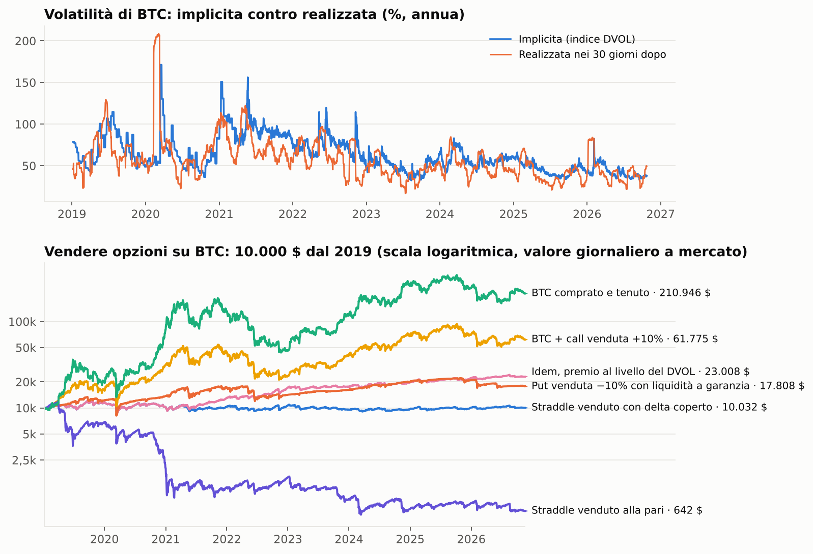

# Nuovo ciclo di ricerca: cosa manca, e la matematica che serve

Quattro cose che nei cicli precedenti non avevamo guardato: quanto sono affidabili i risultati, quanta leva usare, la
volatilità come fonte di rendimento, le opzioni come strumento. Dati fino al 23/11/2026.

> Ricerca su dati storici, non una raccomandazione d'investimento.

## 1. Sintesi

**Nessuna strategia nuova supera la verifica. W3.2 a leva 1x resta la scelta, e 1x è già il massimo compatibile con il tuo
limite di drawdown. Vendere volatilità su BTC sembrava la candidata, ma con i prezzi a cui si vende davvero il guadagno sta
fra zero e +11% annuo, e i nostri dati non bastano a dire dove.**

| Domanda | Risultato | Cosa farne |
|---|---|---|
| I risultati di W3.2 possono essere fortuna? | Da sola, lo Sharpe (1,2) è certamente sopra zero. Contando i tentativi fatti regge fino a una decina (91–98%); contro cento dipende dalle ipotesi (41–81%) | Non aggiungere altre regole a W3.2. Ogni variante provata abbassa la fiducia in tutte |
| Quanta leva su W3.2? | Kelly dice 4x. Ma già a 1x la probabilità di un drawdown oltre −35% in tre anni è del 16%; a 1,5x del 62%, a 2x del 91% | 1x al massimo. Per stare sotto −35% con margine, 0,5–0,75x |
| La volatilità implicita di BTC è troppo cara? | L'indice DVOL è stato sopra la volatilità realizzata nel 67% dei giorni, di 6 punti in media. Sulle opzioni al prezzo corrente il premio è 2 punti | Il premio esiste, ma gran parte sta nelle opzioni lontane dal prezzo |
| Basta vendere opzioni per incassarlo? | No. Straddle e strangle venduti senza copertura: da 10.000 $ a 600–1.500 $, drawdown −88/−95% | Mai opzioni vendute nude su BTC |
| E coprendo il delta ogni giorno? | Fra 0% e +11% annuo, drawdown −27%. Zero se si vende alla volatilità delle opzioni alla pari, +11% se si vende al livello del DVOL | Non dimostrata. Serve una prova con prezzi veri |
| Opzioni comprate al posto del perp per W3.2? | A 30 giorni con il 10% del capitale: 216.000 $ contro 247.000 $ di W3.2, con perdita massima per operazione −10% invece di −18%. A 180 giorni: 36.000 $ | Ipotesi interessante, non una conclusione: 20 operazioni, risultato che cambia di sei volte con la scadenza |
| I dati delle opzioni anticipano il prezzo? | No: inclinazione, volumi put/call e livello della volatilità non prevedono BTC a 4 settimane | Nessun segnale d'ingresso da qui |

Una verifica indipendente ha corretto tre punti della prima versione di questo studio: il premio incassato era calcolato
sull'indice DVOL invece che sulla volatilità delle opzioni alla pari (lo straddle coperto passava da +17% a zero), mancava
il funding sulla copertura, e il drawdown simulato era misurato su dati settimanali invece che giornalieri. I numeri qui
sono quelli corretti.

## 2. Cosa manca: la mappa

Cosa abbiamo già verificato in questo repo, e cosa no.

| Area | Stato | Esito | Dove |
|---|---|---|---|
| Trend settimanale con flussi e funding (W3.2) | Verificato | Funziona: è il riferimento | `CONFRONTO_W32.md`, `W32_INGRESSI_USCITE.md` |
| Analisi tecnica giornaliera (voto di indicatori, tre schermi) | Verificato | Più debole di W3.2 | `ANALISI_BTC.md`, `REGOLE_AT.md` |
| Altcoin con MACD a regime | Verificato | Positivo, molto volatile | `ALGORITMO.md`, `SWING.md` |
| Intraday su BTC | Verificato | Nessun vantaggio dopo i costi | `INTRADAY.md` |
| DCA in ingresso e in uscita, acquisti sul supporto | Verificato | Non migliorano | `W32_INGRESSI_USCITE.md`, `SWING.md` |
| Sentiment, liquidazioni, supporti e resistenze | Verificato | Nessun segnale d'ingresso | `ANALISI_BTC.md`, `LIQUIDAZIONI.md`, `LIVELLI_BTC.md` |
| Carry sul funding | Verificato | Regolare, ma rende il 7% annuo | `STRATEGIE.md` |
| **Affidabilità statistica dei risultati** | **Questo ciclo** | W3.2 regge a pochi tentativi, non a centinaia | § 3 |
| **Leva e dimensione della posizione** | **Questo ciclo** | 1x al massimo | § 4 |
| **Volatilità come fonte di rendimento** | **Questo ciclo** | Premio reale nell'indice, non dimostrato nelle opzioni vendibili | § 5–7 |
| **Opzioni comprate come strumento** | **Questo ciclo** | Ipotesi aperta per scadenze brevi | § 8 |
| **Segnali dal mercato delle opzioni** | **Questo ciclo** | Nessuno sul prezzo | § 9 |
| Prezzi storici veri delle opzioni (per strike e scadenza) | Manca | Decide § 6 e § 8 | Storico Deribit a pagamento, oppure registrare da oggi i prezzi di OKX |
| Base dei futures a scadenza (cash-and-carry) | Manca | Parente del carry sul funding | Storico futures trimestrali OKX/Deribit |
| Flussi on-chain e degli ETF | Manca | Il radar ha già i flussi dei perp | Fornitori esterni |
| Libro ordini e microstruttura | Manca | Rilevante solo per l'intraday, già scartato | Dati tick |
| Arbitraggio statistico fra altcoin (coppie) | Manca | Fattibile con i dati che abbiamo | `data/alts/` |

## 3. Quanto ci si può fidare di un backtest

### La matematica

Lo **Sharpe** misura il rendimento medio per unità di oscillazione: `Sharpe = media / deviazione standard`, portato su base
annua moltiplicando per √52 se i rendimenti sono settimanali.

Uno Sharpe misurato su pochi anni è una stima con un errore. Il **Probabilistic Sharpe Ratio** (Bailey e López de Prado) dà
la probabilità che lo Sharpe vero superi una soglia `S*`:

```
PSR = Φ( (S − S*) · √(n − 1) / √(1 − γ3·S + (γ4 − 1)/4 · S²) )
```

`n` è il numero di osservazioni, `γ3` l'asimmetria, `γ4` la curtosi, `Φ` la distribuzione normale. Rendimenti con code
pesanti o asimmetria negativa allargano l'errore.

Il problema vero è un altro. Se provo 100 varianti e tengo la migliore, quella avrà uno Sharpe alto anche se nessuna
funziona. Lo **Sharpe deflazionato** usa come soglia `S*` lo Sharpe che il migliore di `N` tentativi senza abilità raggiunge
per caso:

```
S* = σ_S · [ (1 − γ)·Φ⁻¹(1 − 1/N) + γ·Φ⁻¹(1 − 1/(N·e)) ]        γ = 0,5772
```

`σ_S` è quanto variano gli Sharpe fra i tentativi. Nelle nostre griglie è 0,31–0,37; nella tabella uso 0,5, più severo.

### I risultati

Dispersione dello Sharpe annuo fra le varianti provate in questa ricerca: 0,31 fra le 104 soglie di v1, 0,37 fra le 126 varianti di v2. Per la colonna "deflazionato" si assume una dispersione di 0,5 fra i tentativi. Sharpe che il migliore di N tentativi senza abilità raggiunge per caso, su base annua: N=10 → 0,79; N=100 → 1,27; N=1.000 → 1,63.

| Strategia | Anni | Sharpe annuo (settimanale) | Asimmetria | Probabilità che lo Sharpe vero sia > 0 | Deflazionato, 10 tentativi | 100 tentativi | 1.000 tentativi | Anni minimi per esserne certi al 95% |
|---|---|---|---|---|---|---|---|---|
| W3.2 radar, 2018–2026 | 8,9 | 1,19 | 1,6 | 100,0% | 91% | 41% | 7% | 1,5 |
| W3.2 radar, dal 2021 (dati reali) | 5,9 | 1,26 | 1,5 | 100,0% | 90% | 49% | 16% | 1,4 |
| v1 · voto di 17 indicatori, 2018–2026 | 8,9 | 0,91 | 1,1 | 99,8% | 65% | 13% | 1% | 2,9 |
| v1, solo verifica 2022–2026 | 4,9 | 0,64 | 1,4 | 93,3% | 37% | 7% | 1% | 5,9 |
| v2 · tre schermi, 2018–2026 | 8,9 | 0,95 | 1,2 | 99,9% | 70% | 16% | 2% | 2,7 |
| MACD a regime (altcoin), dal 2020 | 6,5 | 1,06 | 1,3 | 99,8% | 78% | 29% | 6% | 2,1 |
| Carry funding selettivo, dal 2021 | 5,9 | 2,84 | 4,1 | 100,0% | 100% | 100% | 100% | 0,1 |
| BTC comprato e tenuto, 2018–2026 | 8,9 | 0,56 | -0,1 | 95,0% | 25% | 2% | 0% | 8,9 |

W3.2 2018–2026 con la dispersione misurata invece di 0,5: con 0,37 il deflazionato è 98% / 81% / 49%; con 0,31 è 99% / 91% / 73% (10 / 100 / 1.000 tentativi). I rendimenti settimanali di W3.2 hanno autocorrelazione 0,14: tenendone conto lo Sharpe annuo scende da 1,19 a circa 1,06.

Come leggere:

- **W3.2** ha uno Sharpe di 1,2. Preso da solo è sopra zero con certezza. Contro 10 tentativi regge: 91% con l'ipotesi
  severa, 98% con la dispersione misurata. Contro 100 il risultato dipende dall'ipotesi: 41% oppure 81%. La risposta onesta
  è che non lo sappiamo.
- Quanti tentativi contare per W3.2? È la versione 3.2 di un sistema che ha avuto più revisioni, tarata sul 2021–2026. Non
  sono mille, ma nemmeno uno. La cifra ragionevole è "decine". Il 2018–2020, che non è stato usato per tararla, dà uno
  Sharpe simile: è l'argomento migliore a suo favore.
- **v1 e v2** (analisi tecnica) non reggono: v1 nel periodo di sola verifica ha Sharpe 0,64, cioè 37% contro 10 tentativi.
  Ne avevamo provati 104 e 126.
- **Il carry sul funding** è l'unico che passa qualunque soglia. Ha uno Sharpe di 2,8 perché oscilla pochissimo, ma rende il
  7% annuo: è affidabile, non ricco.
- **BTC comprato e tenuto**: Sharpe 0,56. Servono quasi nove anni di dati solo per dire che è sopra zero.

Conseguenza pratica: ogni nuova regola provata su W3.2 è un tentativo in più. Il modo per aumentare la fiducia non è
cercare altre varianti, è lasciare passare tempo con le regole ferme.

## 4. Quanta leva: crescita composta e Kelly

### La matematica

Il capitale cresce per moltiplicazione, non per somma. Perdere il 50% e poi guadagnare il 50% lascia al 75%. Per questo la
crescita composta è più bassa del rendimento medio, e la differenza cresce con il quadrato dell'oscillazione:

```
crescita ≈ μ − σ²/2                     (μ = rendimento medio annuo, σ = volatilità annua)
con leva L:  crescita ≈ L·μ − L²·σ²/2
```

Il rendimento sale in proporzione alla leva, il costo dell'oscillazione con il quadrato. Esiste quindi una leva che
massimizza la crescita, quella di **Kelly**: `L* = μ / σ²`. Oltre, la crescita scende; a `2·L*` è zero; più in là si perde
tutto anche con una strategia che in media guadagna.

Tre motivi per stare molto sotto Kelly:

1. `μ` è una stima. Se il vantaggio vero è metà di quello misurato, la leva di Kelly "misurata" è il doppio di quella giusta,
   cioè il punto in cui la crescita è zero.
2. Kelly massimizza la crescita, non limita il drawdown. A Kelly pieno un drawdown del 50% è normale.
3. La formula assume rendimenti regolari. BTC ha giorni da −40%.

### I risultati

| Campione | Rendimento medio annuo (aritmetico) | Volatilità annua | Leva di Kelly teorica (media / varianza) | Leva che massimizza la crescita nello storico | Crescita annua a 1x | a metà di quella leva | a quella leva | al doppio | Leva oltre cui la crescita diventa negativa |
|---|---|---|---|---|---|---|---|---|---|
| W3.2, 2018–2026 | +39,1% | +31,3% | 4,0x | 3,25x | +40,7% | +59,6% | +82,4% | -100,0% | 5,25x |
| W3.2, dal 2021 | +40,6% | +30,6% | 4,3x | 3,75x | +43,2% | +72,6% | +102,3% | -100,0% | 7,00x |
| W3.2 dal 2021, con il vantaggio dimezzato | +20,3% | +30,6% | 2,2x | 1,50x | +16,9% | +13,4% | +18,5% | +7,5% | 3,50x |

| Campione | Leva | CAGR mediano a 3 anni | 5° percentile | Probabilità di chiudere in perdita | Drawdown mediano | Probabilità di drawdown oltre −35% | oltre −50% |
|---|---|---|---|---|---|---|---|
| W3.2, 2018–2026 | 0,5x | +21,5% | +3,5% | 2% | -13,4% | 0% | 0% |
| W3.2, 2018–2026 | 1,0x | +44,3% | +5,1% | 3% | -25,9% | 16% | 1% |
| W3.2, 2018–2026 | 1,5x | +62,4% | +1,8% | 4% | -38,5% | 62% | 18% |
| W3.2, 2018–2026 | 2,0x | +78,1% | -3,4% | 6% | -49,7% | 91% | 49% |
| W3.2, 2018–2026 | 3,0x | +98,6% | -19,1% | 11% | -68,6% | 100% | 91% |
| W3.2, dal 2021 | 0,5x | +19,8% | +4,1% | 2% | -13,1% | 0% | 0% |
| W3.2, dal 2021 | 1,0x | +40,6% | +6,1% | 2% | -25,1% | 12% | 1% |
| W3.2, dal 2021 | 1,5x | +56,5% | +3,1% | 4% | -37,2% | 60% | 13% |
| W3.2, dal 2021 | 2,0x | +70,4% | -1,7% | 6% | -48,1% | 90% | 44% |
| W3.2, dal 2021 | 3,0x | +89,0% | -17,2% | 11% | -66,4% | 100% | 90% |

La seconda tabella rimescola a blocchi di 56 giorni i rendimenti giornalieri di W3.2 e simula 4.000 percorsi di tre anni.

- Kelly dice 4x. Nello storico la leva migliore è 3,25–3,75x, e al doppio di quella si azzera il capitale: il giorno peggiore
  di W3.2 è stato −19%, quindi a 5,25x basta quel giorno.
- Con il vantaggio dimezzato la leva migliore scende a 1,5x.
- Con il tuo limite di drawdown a −35%: a 1x la probabilità di superarlo in tre anni è del 12–16%, a 1,5x del 60%, a 2x del
  90%. Nello storico W3.2 a 1x ha già toccato −37,3%.
- A 0,5x la probabilità è zero e la crescita mediana è il 20% annuo.

**La leva giusta per W3.2 è 1x al massimo.** Il rischio del 25% allo stop è già una scelta aggressiva: la versione a 10%
(W3.1) corrisponde a circa 0,4x. La leva fino a 5x che avevi indicato come tetto non serve: fra 1x e 2x il rendimento
mediano sale da +44% a +78%, ma la probabilità di uscire dai tuoi limiti passa dal 16% al 91%.

## 5. Il premio di volatilità

### La matematica

Il prezzo di un'opzione dipende da quanto il mercato si aspetta che BTC oscilli fino alla scadenza: la **volatilità
implicita**. Su Deribit l'indice DVOL la misura a 30 giorni. La **volatilità realizzata** è quella che poi c'è stata davvero.

Se l'implicita è stabilmente più alta della realizzata, chi vende opzioni incassa più di quanto paga: è il **premio di
volatilità**. Esiste su azioni, valute e materie prime per lo stesso motivo per cui un'assicurazione costa più del danno
medio: chi compra protezione accetta di pagarla cara.

Un dettaglio che cambia i conti: il DVOL, come il VIX, è una media su tutti i prezzi d'esercizio, comprese le opzioni
lontane dal prezzo, che sono le più care. Le opzioni **alla pari** (prezzo d'esercizio uguale al prezzo corrente) hanno una
volatilità più bassa: nei nostri dati il 92% del DVOL. Chi vende uno straddle alla pari incassa quella, non il DVOL.

### I risultati

| Periodo | Giorni | Volatilità implicita media (indice DVOL) | Realizzata nei 30 giorni dopo | Differenza media | Mediana | Giorni in cui l'implicita è stata più alta | Giorno peggiore (realizzata − implicita) | Implicita delle opzioni alla pari (stima) | Differenza media alla pari | Giorni in cui è stata più alta |
|---|---|---|---|---|---|---|---|---|---|---|
| 2019 – 03/2021 (IV approssimata) | 808 | 71% | 70% | 1,2 punti | 3,1 | 56% | 157 punti il 2020-02-29 | 71% | 1,2 punti | 56% |
| 03/2021 – 2023 (DVOL) | 1013 | 70% | 58% | 11,8 punti | 12,5 | 74% | 41 punti il 2021-04-28 | 61% | 3,0 punti | 63% |
| 2024 – 2026 (DVOL) | 1028 | 49% | 44% | 4,8 punti | 8,4 | 68% | 46 punti il 2026-01-28 | 46% | 2,0 punti | 62% |
| Tutto | 2849 | 63% | 57% | 6,3 punti | 9,0 | 67% | 157 punti il 2020-02-29 | 59% | 2,1 punti | 60% |

Correlazione fra il premio (implicita − realizzata dopo) e il rendimento di BTC negli stessi 30 giorni: 0,06. Con il valore assoluto del rendimento: -0,37.



- Misurato sull'indice il premio è 6 punti di volatilità, positivo due giorni su tre. Uno studio di CryptoQuant trova lo
  stesso su quattro anni (73,6% dei giorni).
- Misurato sulle opzioni alla pari il premio è 2 punti, positivo nel 60% dei giorni. La differenza sta nelle opzioni lontane
  dal prezzo: è lì che i compratori di protezione pagano di più.
- Si è ridotto: sull'indice, 12 punti nel 2021–2023 e 5 nel 2024–2026. Con più venditori (ETF con covered call, prodotti
  strutturati) il premio scende.
- Non è gratis: il giorno peggiore la realizzata ha superato l'implicita di 157 punti (marzo 2020).
- Il premio è alto quando BTC si muove poco e negativo quando si muove molto (correlazione −0,37 con l'ampiezza del
  movimento). Non dipende dalla direzione (0,06).

## 6. Vendere opzioni: nude contro coperte

### La matematica

- **Straddle venduto**: vendo una call e una put allo stesso prezzo d'esercizio, quello attuale. Incasso due premi. Guadagno
  se BTC resta vicino, perdo se si allontana in una direzione qualsiasi.
- **Strangle venduto**: come lo straddle ma con prezzi d'esercizio lontani (±15%). Premio più piccolo, perdita che parte più
  tardi.
- **Put venduta con liquidità a garanzia**: mi impegno a comprare BTC a −10%. Incasso il premio; se BTC scende sotto, compro.
- **Covered call**: tengo BTC e vendo una call a +10%. Incasso il premio, rinuncio al rialzo oltre.
- **Delta**: di quanto cambia il prezzo dell'opzione se BTC si muove di 1 $. Uno straddle appena venduto ha delta circa zero;
  se BTC sale diventa una scommessa al ribasso, se scende una al rialzo.
- **Copertura del delta**: ogni giorno compro o vendo sul perp la quantità che riporta il delta a zero. Così la posizione non
  dipende più da dove va BTC ma solo da quanto oscilla: guadagno se la volatilità realizzata è sotto quella che ho venduto.

In formula, il guadagno giornaliero di uno straddle venduto e coperto è circa
`½ · Γ · S² · (σ²_implicita − σ²_realizzata) · Δt`: è esattamente il premio di volatilità. Senza copertura, a questo si somma
una scommessa sulla direzione che nessuno ha chiesto.

### I risultati

Opzioni a 30 giorni, sei comparti aperti a cinque giorni l'uno dall'altro, valore calcolato ogni giorno. Volatilità di
vendita: quella stimata delle opzioni alla pari. Costi: 4% del premio per lato come differenza denaro-lettera, 0,03% di
commissione, 0,015% al regolamento, 0,05% su ogni ribilanciamento della copertura, funding storico sul perp usato per coprire.

| Strategia (scadenze a 30 giorni, 6 comparti sfalsati) | 10.000 $ → | CAGR | Max DD | Sharpe | Mese peggiore | Cicli in guadagno | CAGR / DD 2019–03/2021 | CAGR / DD 03/2021–2023 | CAGR / DD 2024–2026 |
|---|---|---|---|---|---|---|---|---|---|
| Straddle venduto alla pari, 1x | 642 | -29,5% | -95,0% | -0,53 | -41,6% | 56% di 569 | -61% / -92% | -13% / -49% | -10% / -40% |
| Straddle venduto, 0,25x | 6.187 | -5,9% | -43,2% | -0,57 | -10,6% | 56% di 569 | -16% / -38% | -2% / -13% | -1% / -11% |
| Straddle venduto con copertura giornaliera del delta, 1x | 10.032 | +0,0% | -26,8% | 0,07 | -11,4% | 54% di 569 | +2% / -27% | -3% / -16% | +2% / -9% |
| · controllo: senza funding (copertura con il future della stessa scadenza) | 13.831 | +4,2% | -21,6% | 0,39 | -7,9% | 56% di 569 | +10% / -22% | +1% / -13% | +3% / -9% |
| · controllo: premio incassato al livello del DVOL (ottimistico) | 23.008 | +11,2% | -26,8% | 0,86 | -11,4% | 60% di 569 | +2% / -27% | +22% / -13% | +10% / -8% |
| Straddle coperto, solo se implicita > realizzata passata | 9.460 | -0,7% | -21,4% | -0,03 | -9,5% | 51% di 358 | +4% / -16% | -4% / -16% | -0% / -8% |
| Straddle coperto, solo se implicita sopra la sua mediana a un anno | 17.836 | +7,6% | -13,3% | 1,10 | -7,1% | 67% di 206 | +16% / -13% | +3% / -13% | +6% / -6% |
| Strangle ±15% con copertura giornaliera del delta, 1x | 8.038 | -2,7% | -28,9% | -0,19 | -15,2% | 54% di 569 | -5% / -29% | -2% / -13% | -2% / -7% |
| Strangle venduto ±15%, 1x | 1.462 | -21,7% | -87,6% | -0,48 | -34,9% | 70% di 569 | -49% / -85% | -6% / -32% | -9% / -31% |
| Strangle ±15%, solo se implicita > realizzata passata | 4.380 | -10,0% | -61,9% | -0,34 | -19,4% | 69% di 358 | -17% / -52% | -6% / -28% | -8% / -26% |
| Put venduta −10% con liquidità a garanzia | 17.808 | +7,6% | -39,1% | 0,44 | -20,1% | 84% di 569 | +25% / -39% | -0% / -33% | +3% / -23% |
| Put venduta −10%, solo sopra la SMA 200 | 16.278 | +6,4% | -33,6% | 0,48 | -18,5% | 86% di 332 | +14% / -34% | +0% / -25% | +7% / -8% |
| BTC + call venduta +10% (covered call) | 61.775 | +26,1% | -60,6% | 0,76 | -32,0% | 65% di 569 | +99% / -49% | -4% / -61% | +15% / -45% |
| BTC comprato e tenuto (riferimento) | 210.946 | +47,4% | -76,6% | 0,95 | -37,3% | 57% di 569 | +241% / -63% | -7% / -77% | +21% / -53% |

- **Nude**: straddle e strangle venduti perdono quasi tutto. Il premio incassato non compensa le perdite di direzione: fra
  ottobre 2020 e aprile 2021 BTC ha fatto ×5 e le call vendute hanno assorbito tutto. Anche a un quarto dell'esposizione il
  risultato resta negativo.
- **Put venduta e covered call**: sono BTC comprato con il rialzo tagliato. La put venduta rende il 7,6% annuo con un
  drawdown del −39%; la covered call fa +26% con drawdown −61%, contro +47% e −77% di BTC tenuto.
- **Con il delta coperto**: lo straddle passa da −30% annuo a **zero**. La copertura toglie la scommessa sulla direzione, ma
  il premio di 2 punti che resta è mangiato da costi e funding.
- **Tutto dipende dal prezzo a cui si vende.** Se si riuscisse a vendere al livello del DVOL il risultato sarebbe +11% annuo
  con Sharpe 0,86 (riga di controllo). La verità sta fra i due: la nostra stima della volatilità alla pari viene dagli
  scambi della domenica, di cui non conosciamo la scadenza media, e potrebbe essere troppo bassa. Con questi dati
  l'intervallo non si stringe.
- **Il funding conta.** Quando BTC sale, lo straddle venduto diventa una posizione al ribasso e la copertura è un long sul
  perp, che paga il funding proprio quando è alto. Costa circa 4 punti l'anno (riga di controllo senza funding: +4%). Chi
  copre con il future della stessa scadenza delle opzioni evita questo costo.
- **Filtro "implicita > realizzata passata"**: non migliora. È la regola più citata e qui non funziona.
- **Filtro "implicita sopra la sua mediana a un anno"**: +7,6% annuo, drawdown −13%, Sharpe 1,10, positivo nei tre periodi.
  L'ho provato dopo aver visto § 9, cioè guardando gli stessi dati su cui lo misuro: è un'ipotesi, non un risultato.

### Quanto costa un giorno brutto

Uno straddle appena venduto, coperto alla chiusura del giorno prima: perdita in un solo giorno, in percentuale del
controvalore, se BTC si muove e la volatilità implicita sale.

| Movimento di BTC in un giorno | Volatilità implicita 50% → 50% | 50% → 80% | 50% → 120% |
|---|---|---|---|
| fermo | +0,2% | -6,5% | -15,4% |
| +5% | -0,5% | -7,1% | -16,1% |
| -5% | -0,5% | -6,8% | -15,3% |
| +10% | -2,4% | -8,5% | -17,3% |
| -10% | -2,7% | -8,0% | -15,9% |
| +20% | -8,9% | -13,3% | -21,1% |
| -20% | -10,3% | -13,1% | -18,9% |
| -30% | -20,3% | -21,2% | -24,5% |
| -40% | -30,9% | -31,0% | -32,3% |

Premio incassato all'apertura: 11,4% del controvalore. Guadagno massimo se BTC resta fermo fino a scadenza: lo stesso 11,4%.

Un mese fermo rende l'11%. Un giorno da −20% con volatilità che sale costa il 13–19%: più di un mese di premio. Un giorno da
−40% come il 12/03/2020 costa il 31%. La copertura giornaliera non protegge dai salti dentro la giornata.

### L'esame dello Sharpe deflazionato

| Serie | Anni | Sharpe annuo (settimanale) | Asimmetria | Giorno peggiore | Settimana peggiore | Probabilità che lo Sharpe vero sia > 0 | Deflazionato, 10 tentativi | 100 tentativi |
|---|---|---|---|---|---|---|---|---|
| Straddle coperto, 2019–2026 | 7,9 | 0,09 | -2,1 | -12,6% | -16,5% | 59,6% | 3% | 0% |
| Straddle coperto, dal 24/03/2021 | 5,7 | -0,03 | -2,0 | -6,4% | -11,7% | 47,5% | 3% | 0% |
| Con il premio al livello del DVOL, 2019–2026 | 7,9 | 0,72 | -2,1 | -12,6% | -16,5% | 96,6% | 43% | 8% |
| Con il premio al livello del DVOL, dal 24/03/2021 | 5,7 | 1,16 | -1,8 | -6,9% | -11,7% | 99,1% | 78% | 41% |

L'asimmetria è negativa (−2): molti piccoli guadagni e poche perdite grandi, il contrario di W3.2 (+1,6). È il profilo di
chi vende assicurazioni. In questo ciclo ho provato una dozzina di varianti con opzioni, quindi la colonna da guardare è
"10 tentativi": anche nell'ipotesi ottimistica lo straddle coperto non passa sull'intero periodo (43%) e passa a fatica
sul periodo con il DVOL (78%).

## 7. Insieme a W3.2

| Combinazione (ribilanciata ogni giorno, dal 2019) | CAGR | Max DD | Sharpe | Correlazione mensile con W3.2 |
|---|---|---|---|---|
| W3.2 da sola | +48,5% | -37,3% | 1,39 | – |
| 80% W3.2 + 20% liquidità (riferimento) | +38,3% | -30,7% | 1,39 | – |
| 80% W3.2 + 20% straddle venduto con copertura giornaliera del delta, 1x | +38,6% | -31,5% | 1,41 | -0,25 |
| 80% W3.2 + 20% put venduta −10% con liquidità a garanzia | +41,1% | -30,1% | 1,46 | 0,12 |
| 80% W3.2 + 20% put venduta −10%, solo sopra la sma 200 | +40,2% | -32,5% | 1,42 | 0,32 |

Il confronto giusto è con la riga "80% W3.2 + 20% liquidità": stessa esposizione a W3.2, con il 20% fermo. Sostituire
quella liquidità con lo straddle coperto non cambia nulla (+38,6% contro +38,3%). La correlazione mensile con W3.2 è
negativa (−0,25), quindi diversificherebbe: ma serve un rendimento proprio, e con i prezzi realistici non c'è.

La put venduta aggiunge tre punti, ma è BTC comprato in un'altra forma: sale con il mercato e perde quando W3.2 è già in
difficoltà.

## 8. W3.2 con opzioni comprate

Idea: invece di aprire spot o perp con lo stop, a ogni segnale di W3.2 comprare un'opzione alla pari (call per i long, put
per gli short) con una quota fissa del capitale. La perdita massima è il premio pagato, senza stop e senza liquidazione. Se
l'opzione scade prima che W3.2 esca, l'operazione finisce lì.

Operazioni di W3.2 dal 2019-01-06 (prima non c'è volatilità implicita): 20. A ogni ingresso si compra un'opzione alla pari (call per i long, put per gli short) spendendo una quota fissa del capitale; si rivende quando W3.2 esce, o si incassa il valore a scadenza. Costo denaro-lettera: 4% del premio per lato.

| Versione | Capitale finale da 10.000 $ | Operazioni in guadagno | Operazione peggiore | Operazione migliore | Perdita massima per operazione | Capitale composto nelle sole perdenti consecutive peggiori |
|---|---|---|---|---|---|---|
| W3.2 originale (spot e perp) | 246.794 | 85% | -17,9% | +52,2% | fino a −25% (stop) | -20,0% |
| W3.1 (stessi segnali, rischio 10% allo stop) | 49.142 | 85% | -7,2% | +24,6% | fino a −10% (stop) | -8,1% |
| Opzione a 30 giorni, 6% del capitale per operazione | 72.223 | 75% | -6,0% | +40,9% | −6% | -8,5% |
| Opzione a 30 giorni, 10% del capitale per operazione | 216.082 | 75% | -10,0% | +68,1% | −10% | -13,9% |
| Opzione a 90 giorni, 6% del capitale per operazione | 44.763 | 65% | -5,9% | +25,8% | −6% | -7,3% |
| Opzione a 90 giorni, 10% del capitale per operazione | 106.384 | 65% | -9,8% | +42,9% | −10% | -12,0% |
| Opzione a 180 giorni, 6% del capitale per operazione | 22.173 | 50% | -5,5% | +16,5% | −6% | -5,8% |
| Opzione a 180 giorni, 10% del capitale per operazione | 35.646 | 50% | -9,2% | +27,5% | −10% | -9,7% |
| Opzione a 30 giorni, 10% del capitale per operazione, pagata al livello del DVOL | 167.639 | 70% | -10,0% | +68,1% | −10% | -13,9% |
| Opzione a 90 giorni, 10% del capitale per operazione, pagata al livello del DVOL | 87.497 | 65% | -9,8% | +40,5% | −10% | -12,2% |

- **La scadenza decide tutto.** Con il 10% del capitale per operazione: 216.000 $ a 30 giorni, 106.000 $ a 90, 36.000 $ a
  180. L'opzione corta costa meno e amplifica di più il movimento dei primi giorni, che è dove W3.2 guadagna.
- **A 30 giorni il risultato è vicino a W3.2 originale** (247.000 $) con una perdita massima per operazione del −10% invece
  del −18%, e una serie peggiore di perdite del −14% invece del −20%.
- **A rischio simile batte W3.1**: 72.000 $ con il 6% a 30 giorni, contro 49.000 $ di W3.1 con perdite paragonabili.
- **Regge a un prezzo più alto**: pagando l'opzione al livello del DVOL si scende a 168.000 $.
- Le operazioni in guadagno calano dall'85% al 75%: l'opzione perde valore ogni giorno, e un'operazione lenta chiude in
  perdita anche se la direzione era giusta.

Perché non è una conclusione:

1. Sono 20 operazioni. Tre perdite piene di fila a 10% fanno −27%, e nello storico non è mai successo solo perché W3.2 ha
   avuto l'85% di operazioni in guadagno.
2. La scadenza di 30 giorni è la migliore fra le tre provate, scelta a posteriori. Fra la migliore e la peggiore c'è un
   fattore sei.
3. I prezzi sono calcolati con una formula e una volatilità a 30 giorni, non osservati.
4. È leva in un'altra forma: il 10% in opzioni a 30 giorni muove circa 1,5 volte il capitale. § 4 dice cosa fa la leva
   quando il vantaggio è più piccolo del previsto.

È però l'unica idea di questo ciclo che, se confermata con prezzi veri, cambierebbe il modo di eseguire W3.2: stesso
segnale, rischio definito in partenza, nessuno stop che può essere saltato.

| Operazione W3.2 | Verso | Entra | Esce | W3.2 originale | Con opzione a 30 giorni (10% del capitale) | Con opzione a 90 giorni (10% del capitale) |
|---|---|---|---|---|---|---|
| 1 | long | 2019-05-13 | 2019-06-27 | +51,1% | +2,1% | +18,0% |
| 2 | long | 2020-02-10 | 2020-02-17 | -2,6% | -2,7% | -1,1% |
| 3 | short | 2020-03-16 | 2020-04-27 | -17,9% | -10,0% | -9,8% |
| 4 | long | 2020-05-04 | 2020-08-03 | +16,0% | -1,8% | +12,3% |
| 5 | long | 2020-10-26 | 2020-11-23 | +40,8% | +56,4% | +30,2% |
| 6 | long | 2020-12-14 | 2020-12-31 | +50,4% | +68,1% | +37,8% |
| 7 | long | 2021-02-01 | 2021-02-22 | +52,2% | +44,1% | +22,8% |
| 8 | long | 2021-08-02 | 2021-09-27 | +4,3% | +9,6% | -1,5% |
| 9 | long | 2021-10-04 | 2021-11-08 | +20,9% | +26,4% | +12,4% |
| 10 | short | 2022-01-03 | 2022-03-28 | +1,0% | +13,5% | -7,5% |
| 11 | short | 2022-08-15 | 2023-01-16 | +8,3% | +12,4% | +13,5% |
| 12 | long | 2023-01-23 | 2023-08-17 | +13,3% | +3,1% | +12,1% |
| 13 | long | 2023-10-23 | 2024-01-01 | +40,5% | +29,0% | +36,1% |
| 14 | long | 2024-02-12 | 2024-03-11 | +42,2% | +62,2% | +34,0% |
| 15 | long | 2024-09-23 | 2025-02-26 | +30,8% | +0,4% | +42,9% |
| 16 | long | 2025-04-28 | 2025-10-10 | +11,3% | +19,2% | +16,9% |
| 17 | short | 2025-12-01 | 2026-04-27 | +11,9% | -6,3% | +16,9% |
| 18 | short | 2026-05-25 | 2026-08-20 | +5,7% | +35,1% | -3,3% |
| 19 | long | 2026-08-24 | 2026-11-09 | -4,1% | +12,8% | -8,4% |
| 20 | short | 2026-11-16 | aperta | +5,9% | -0,4% | -0,6% |

## 9. I dati delle opzioni anticipano il prezzo?

Quattro segnali presi ogni domenica dai dati Deribit dal 2019, contro il rendimento di BTC e il premio di volatilità nelle
quattro settimane dopo.

| Segnale la domenica | Settimane | BTC nelle 4 settimane dopo: terzo basso del segnale | terzo medio | terzo alto | Correlazione col rendimento, 2019–2022 | 2023–2026 | Correlazione col premio poi incassato (implicita − realizzata dopo), 2019–2022 | 2023–2026 |
|---|---|---|---|---|---|---|---|---|
| Inclinazione: put lontane − call lontane (punti di volatilità) | 408 | +7,4% | +1,1% | +5,2% | -0,02 | -0,03 | 0,12 | -0,13 |
| Livello della volatilità implicita (posizione nelle 52 settimane prima) | 357 | +2,8% | +1,3% | +8,0% | 0,21 | 0,05 | 0,40 | 0,33 |
| Premio atteso: implicita − realizzata dei 30 giorni prima | 408 | +7,7% | +2,7% | +3,2% | -0,12 | -0,04 | -0,01 | -0,11 |
| Volumi: put / call | 408 | +4,6% | +5,3% | +3,8% | -0,06 | -0,02 | -0,02 | 0,05 |

Rendimento medio di BTC a 4 settimane su tutte le domeniche: +4,6%. Le finestre si sovrappongono (4 settimane su dati settimanali): le osservazioni indipendenti sono circa 102 per l'intero periodo, la metà per ogni sottoperiodo; una correlazione sotto 0,2 in valore assoluto non è distinguibile dal caso.

- **Sul prezzo: niente.** Nessun segnale ha una correlazione stabile con il rendimento di BTC. Il livello della volatilità
  implicita sembrava funzionare nel 2019–2022 (0,21) e non più dopo (0,05).
- **Sul premio: il livello della volatilità implicita.** Quando l'implicita è alta rispetto al suo ultimo anno, il premio
  incassato dopo è più alto (0,40 e 0,33 nei due periodi). È l'origine del filtro provato in § 6.
- L'inclinazione (put più care delle call) e il rapporto put/call non dicono nulla, né sul prezzo né sul premio.

## 10. Cosa cambia in pratica

Niente di operativo, e tre cose da tenere ferme:

1. **W3.2 a 1x, senza nuove regole.** Ogni variante aggiunta costa fiducia (§ 3) e ogni punto di leva oltre 1x costa
   drawdown più di quanto renda (§ 4).
2. **Nessuna opzione venduta**, né nuda né coperta, finché non ci sono prezzi veri. Il backtest dice "fra 0 e +11%" con un
   rischio di −31% in un giorno: non è una base per mettere soldi.
3. **Le opzioni comprate sui segnali di W3.2** sono l'ipotesi da verificare per prima. Si può fare senza rischio: a ogni
   segnale di W3.2 annotare il prezzo vero dell'opzione alla pari a 30 giorni su OKX, e dopo un anno confrontare.

## 11. Limiti

- **Prezzi delle opzioni calcolati, non osservati.** Formula di Black con un'unica volatilità per tutti i prezzi d'esercizio.
  Nella realtà le put lontane dal prezzo hanno volatilità più alta: il backtest sottostima il premio di strangle e put
  vendute.
- **La volatilità alla pari è una stima.** DVOL moltiplicato per il rapporto mediano delle ultime 8 domeniche fra la
  volatilità alla pari degli scambi e il DVOL. La scadenza media di quegli scambi non è nota. È il limite che pesa di più:
  sposta lo straddle coperto fra 0 e +11%.
- **Prima del 24/03/2021 non c'è il DVOL.** Uso la volatilità alla pari degli scambi della domenica, tenuta ferma fino alla
  domenica dopo. Nel marzo 2020 la volatilità usata resta al 53% per una settimana mentre quella vera superava il 150%: le
  perdite a mercato di quei giorni sono sottostimate.
- **Copertura alla chiusura giornaliera**, una volta al giorno.
- **Funding e base.** Le opzioni coperte sono prezzate sul prezzo a termine, stimato con il funding dei 7 giorni precedenti;
  la base vera dei future può essere diversa. Prima del 2020 il funding non c'è e uso la media storica (11,6% annuo).
- **Giorno di partenza.** Con sei comparti sfalsati il risultato dipende meno dal giorno in cui si comincia, ma i singoli
  comparti differiscono molto fra loro.
- **Lo Sharpe deflazionato dipende da due numeri scelti**: quanti tentativi contare e quanto variano fra loro. Per questo ho
  mostrato tre valori di N e due di dispersione.
- **Kelly e bootstrap usano i rendimenti passati di W3.2.** Se il vantaggio futuro è più basso, tutte le leve vanno ridotte.
  Il bootstrap a blocchi conserva le sequenze fino a 56 giorni, non i cicli di più anni.
- **Opzioni comprate (§ 8)**: volatilità a 30 giorni usata anche per le scadenze a 90 e 180.

## 12. Prossimo ciclo

In ordine di utilità:

1. **Registrare i prezzi veri delle opzioni.** OKX li pubblica: uno script che ogni giorno salva la catena delle opzioni su
   BTC risolve in pochi mesi il dubbio di § 6 e § 8. Si può aggiungere al radar.
2. **Opzioni comprate sui segnali di W3.2 con prezzi storici veri**, se si trova lo storico (Deribit lo vende; alcuni
   archivi sono gratuiti).
3. **Base dei futures a scadenza**: stesso principio del carry sul funding, con un rendimento fissato all'ingresso.
4. **Coppie fra altcoin**: l'unica famiglia di strategie non direzionali che i dati già presenti permettono di provare.
5. **Nessuna nuova variante di W3.2**: § 3 spiega perché.

## 13. Fonti

- Bailey, López de Prado, *The Deflated Sharpe Ratio* — [SSRN 2460551](https://papers.ssrn.com/abstract=2460551);
  [voce Wikipedia](https://en.wikipedia.org/wiki/Deflated_Sharpe_ratio)
- MacLean, Thorp, Ziemba, *The Kelly Capital Growth Investment Criterion* —
  [capitolo 1](https://www.maths.ed.ac.uk/mckinnon/blackouts/StochOptFinanceAndEnergySpringer/Chap1_KellyZiemba.pdf);
  [Kelly criterion, Wikipedia](https://en.wikipedia.org/wiki/Kelly_criterion)
- *Tackling estimation risk in Kelly investing using options* — [arXiv 2508.18868](https://arxiv.org/pdf/2508.18868)
- Alexander, Imeraj, *The Bitcoin VIX and its Variance Risk Premium* — [Sussex](https://sro.sussex.ac.uk/id/eprint/91094/)
- *Risk Premia in the Bitcoin Market* — [arXiv 2410.15195](https://arxiv.org/html/2410.15195v2)
- CryptoQuant, opzioni su Bitcoin: volatilità prezzata contro realizzata —
  [nota](https://cryptoquant.com/insights/quicktake/6ad17a06a30b2764be042a93-Bitcoin-Options-Priced-More-Volatility-Than-Delivered-on-736-of-Days-Over-Four-Y)
- Dati: indice DVOL e scambi di opzioni Deribit (`data/opzioni/`), copie dal repo radar; prezzi BTC da Binance.

Codice: `backtest/ricerca_nuova.py`. Tabelle: `results/ricerca/tables.md`.
