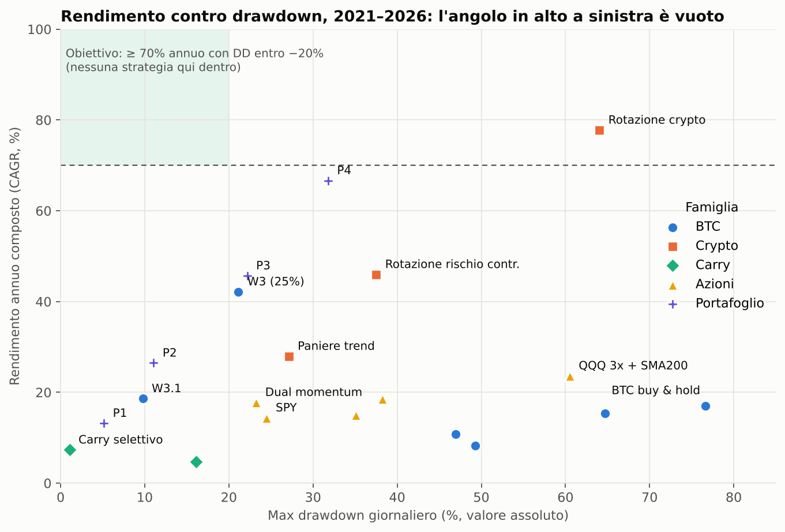
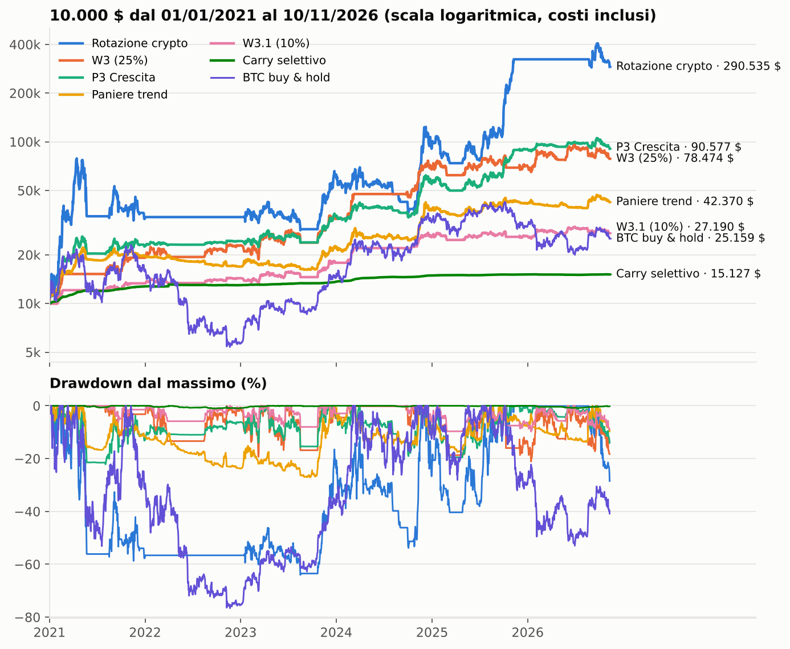

# Strategie a confronto · backtest dal 01/01/2021

Analisi del repo [`andreagalanti91/radar`](https://github.com/andreagalanti91/radar) e ricerca di una strategia con
**rendimento superiore al 70% e drawdown minimo**. Data del report: 22/11/2026. Periodo dei backtest: 01/01/2021 → 10/11/2026
(5,9 anni), 10.000 $ iniziali, costi inclusi.

> Questo documento è ricerca su dati storici, non una raccomandazione d'investimento. Un backtest non garantisce i risultati
> futuri; i limiti sono elencati al [capitolo 9](#9-limiti).

## 1. Sintesi

**Nessuna delle 20 strategie e portafogli testati ottiene più del 70% annuo con un drawdown contenuto.** L'obiettivo va letto
in due modi, e la risposta cambia:

| Lettura dell'obiettivo | Risposta dei dati |
|---|---|
| **> 70% totale** dal 2021 | Già raggiunto: W3.1 del repo radar fa +172% con drawdown −9,8%. Tredici strategie su 16 superano il +70% totale. |
| **> 70% annuo** (CAGR) | Raggiunto solo con drawdown da −35% in su. Le due strade sono la **leva 2x su W3** (+82% annuo, DD −35%) e la **rotazione momentum su crypto** (+78% annuo, DD −64%, risultato gonfiato dalla scelta a posteriori delle monete). |
| **> 70% di operazioni vincenti** | Già raggiunto: W3.1 ha 12 trade vincenti su 13 (92%). |

I quattro risultati che contano:

1. **La strategia migliore per unità di rischio resta W3 del repo radar.** Con rischio 10% (W3.1) rende il 18,6% annuo con
   DD −9,8%; con rischio 25% il 42,2% annuo con DD −21,1%. Nessuna strategia direzionale alternativa ha un rapporto
   rendimento/drawdown (MAR) migliore.
2. **Il 70% annuo si compra con la leva, e il drawdown cresce in proporzione.** W3 al 25% di rischio con leva 2x: 10.000 →
   334.535 $, +82% annuo, DD −35%, entrambe le metà del periodo sopra il 65% annuo. È il candidato più solido, ma poggia su 13
   trade e sul giorno di decisione più fortunato (capitolo 6).
3. **La rotazione momentum su crypto supera il 70% annuo da sola, ma non è credibile così com'è.** L'universo contiene le
   monete che *oggi* sono nelle prime dieci: tolta ZEC (entrata in classifica dopo il rialzo del 2025) il rendimento scende dal
   78% al 47% annuo e nel 2024–26 dal 71% al 18%, con drawdown fra −64% e −73%.
4. **Il drawdown si abbassa combinando strategie poco correlate, non cercando un indicatore migliore.** Il carry sul funding
   (neutrale al prezzo) ha DD −1,1% ma rende il 7% annuo, in calo al 4% dal 2024. Un terzo ciascuno di W3 al 25%, paniere
   trend e carry dà il 26,5% annuo con DD −11,1%.

**Proposta di lavoro** (dettagli al capitolo 8): tenere W3 come nucleo e decidere, con le risposte alle
[domande del capitolo 10](#10-domande-per-ottimizzare-la-strategia), quanta leva e quanta diversificazione aggiungere. Con i dati
dal 2021, un obiettivo coerente è **25–45% annuo con drawdown fra −11% e −22%**; il 70% annuo richiede di accettare un
drawdown storico di almeno −35%, e in futuro probabilmente più ampio.



## 2. Analisi del repo radar

| Aspetto | Cosa c'è |
|---|---|
| Scopo | Segnali su Bitcoin con una sola strategia, W3.1 settimanale, usata con capitale reale (`RADAR_CAPITAL` 50.000 $). |
| Regole di W3.1 | Candela settimanale chiusa la domenica, esecuzione il lunedì. Long in spot se chiusura > SMA 40 settimanale, EMA 20 in salita, chiusura > EMA 21 e flusso perp positivo (più filtro MACD 8/21/5 nei trend vecchi). Short in perp con regole specchiate. Uscita: trailing 2,5 ATR settimanali, chiusura oltre la EMA 21, oppure "distribuzione" (funding alto con flusso contrario). |
| Dimensione | Esposizione = min(1, 10% / distanza dello stop): la perdita allo stop iniziale non supera il 10% della quota. |
| Risultato dichiarato | 10.000 → 27.190 $ dal 2021, DD −9,8%, 13 trade, 92% vincenti. **Riprodotto qui al dollaro** con il codice originale (`vendor/radar_weekly.py`). |
| Infrastruttura | Dashboard oraria su GitHub Pages, bot Telegram, order book di sei borse, liquidazioni, notizie, registro dei trade reali, controlli di coerenza dei dati. |
| Metodo di ricerca | Preregistrazione committata prima dei risultati, periodi separati, placebo, correzione per test multipli, revisione critica. 108 lezioni numerate in `RESEARCH.md`. |

Punti di forza: disciplina di ricerca rara (ipotesi scritte prima dei risultati, esiti negativi conservati), costi e funding
reali nel simulatore, stesso dato nel backtest e dal vivo.

Punti deboli, dichiarati dal repo stesso:

- **13 trade in sei anni.** Tre trade fanno il 59% del rendimento; il campione è troppo piccolo per stimare con precisione il
  rendimento atteso.
- **Giorno di decisione.** La domenica è il giorno migliore per caso: la mediana dei sette giorni possibili è circa 25.000 $
  (contro 27.190) al 10% di rischio e circa 63.000 $ (contro 78.474) al 25%, con drawdown fino a −19% al 10%.
- **Uscita "distribuzione".** Ha chiuso i tre trade migliori con margini minimi sulle soglie di funding.
- **Un solo asset.** W3 non si trasferisce: nei test del repo passa solo BTC (ETH come seconda scelta), 0 su 13 fra indici, oro
  e azioni.

Il repo ha già scartato, con test propri: swing su supporti e resistenze (0/405 configurazioni), intraday 1h–4h, indicatori
classici (MACD, Ichimoku, RSI), liquidazioni, order book, market maker, macro, opzioni, piramidazione, ingressi a scaglioni.
Questo report non li ripete e testa quello che nel repo manca: **strategie su più crypto insieme, carry sul funding, ETF e
portafogli di strategie**.

## 3. Metodo

- **Dati**: gli stessi dataset congelati nel repo radar (commit `da61c5a`), copiati in `data/`: spot, perp e funding Binance di
  11 crypto, feature di BTC, ETF e azioni Yahoo rettificati, Fed Funds. Le fonti di mercato in tempo reale non erano
  raggiungibili da questa sessione (rete limitata), quindi nessun dato è stato scaricato di nuovo; l'ultima data comune è il
  10/11/2026.
- **Esecuzione**: segnale sulla chiusura del giorno *t*, posizione attiva dal giorno *t*+1. Per ETF e azioni un giorno di
  ritardo in più.
- **Costi per lato**: crypto spot 0,20% (0,10% commissione + 0,10% slippage, come in radar), perp 0,15%, ETF 0,05%. Funding
  reale sui perp. La liquidità non rende (scelta prudente, come in radar). La leva costa Fed Funds + 1% annuo.
- **Parametri fissati prima dei risultati**, presi dalla letteratura o dai valori più diffusi, senza ottimizzazione. La
  sensibilità ai parametri è misurata a parte (capitolo 6).
- **Metriche**: capitale finale, CAGR (rendimento annuo composto), drawdown massimo giornaliero, Sharpe a tasso zero, MAR =
  CAGR / |drawdown|, anno peggiore, risultati separati per 2021–23 e 2024–26.

Le strategie:

| Strategia | Regola | Fonte dell'idea |
|---|---|---|
| W3.1 e W3 (radar) | Trend settimanale su BTC con flusso perp, rischio allo stop 10% o 25% | repo radar |
| BTC sopra SMA200 | Long sopra la media a 200 giorni, liquidità sotto | Faber (2007) |
| BTC ensemble Donchian | Media di 9 modelli a rottura dei massimi (5–360 giorni), stop sul punto medio del canale, esposizione scalata sulla volatilità | Zarattini, Pagani, Barbon (2025) |
| BTC TSMOM long/short | Segno dei rendimenti a 30/90/180 giorni su perp, volatilità obiettivo 50% | letteratura sul time-series momentum |
| Paniere trend 11 crypto | Lo stesso ensemble su 11 monete, pesi a rischio uguale, solo long, senza leva | Zarattini, Pagani, Barbon (2025) |
| Rotazione momentum crypto | Ogni domenica le 3 monete con il miglior rendimento a 30 giorni (se positivo); liquidità se BTC è sotto la SMA200 | momentum cross-sectional |
| Rotazione a rischio controllato | Come sopra, con il peso di ogni moneta ridotto quando la sua volatilità supera il 60% | variante |
| Carry funding | Long spot + short perp di pari importo su BTC, ETH, SOL: incassa il funding. "Selettivo": attivo solo se il funding medio a 14 giorni supera il 3,65% annuo | He, Manela, Ross, von Wachter (2022) |
| Dual momentum | A fine mese l'ETF migliore a 12 mesi fra SPY, QQQ, GLD, solo se positivo | Antonacci |
| QQQ 3x + SMA200 | Nasdaq-100 a leva 3x (serie sintetica) solo sopra la media a 200 giorni | strategia retail diffusa |
| Momentum 10 mega-cap (*) | Le 3 azioni migliori a 6 mesi fra le 10 maggiori di oggi | (*) universo scelto a posteriori: solo come limite superiore |
| Portafogli P1–P4 | Combinazioni a pesi fissi delle strategie sopra | – |

## 4. Confronto

| Strategia | Famiglia | 10.000 $ → | Totale | CAGR | Max DD | Sharpe | MAR | Anno peggiore | Tempo a mercato | ≥ 70% annuo? |
|---|---|---|---|---|---|---|---|---|---|---|
| BTC buy & hold | BTC | 25.159 | +152% | +17,1% | -76,6% | 0,56 | 0,22 | -64% | 100% | no |
| W3.1 radar (rischio 10%) | BTC | 27.190 | +172% | +18,6% | -9,8% | 1,26 | 1,91 | +1% | 61% | no |
| W3 radar (rischio 25%) | BTC | 78.474 | +685% | +42,2% | -21,1% | 1,30 | 2,00 | +5% | 61% | no |
| BTC sopra SMA200 | BTC | 23.039 | +130% | +15,3% | -64,7% | 0,55 | 0,24 | -24% | 56% | no |
| BTC ensemble Donchian | BTC | 18.249 | +82% | +10,8% | -46,9% | 0,52 | 0,23 | -25% | 82% | no |
| BTC TSMOM long/short perp | BTC | 15.941 | +59% | +8,3% | -49,3% | 0,40 | 0,17 | -9% | 100% | no |
| Paniere trend 11 crypto | Crypto | 42.370 | +324% | +28,0% | -27,1% | 1,28 | 1,03 | -14% | 96% | no |
| Rotazione momentum crypto | Crypto | 290.535 | +2805% | +77,8% | -64,0% | 1,22 | 1,21 | -10% | 54% | sì |
| Rotazione a rischio controllato | Crypto | 91.645 | +816% | +46,0% | -37,5% | 1,16 | 1,23 | -8% | 54% | no |
| Carry funding sempre attivo | Carry | 13.071 | +31% | +4,7% | -16,1% | 0,91 | 0,29 | -13% | 100% | no |
| Carry funding selettivo | Carry | 15.127 | +51% | +7,3% | -1,1% | 4,50 | 6,93 | +0% | 93% | no |
| SPY buy & hold | Azioni | 21.954 | +120% | +14,4% | -24,5% | 0,89 | 0,59 | -18% | 100% | no |
| QQQ buy & hold | Azioni | 22.556 | +126% | +14,9% | -35,1% | 0,73 | 0,42 | -33% | 100% | no |
| Dual momentum SPY/QQQ/GLD | Azioni | 26.058 | +161% | +17,8% | -23,2% | 0,95 | 0,77 | -15% | 88% | no |
| QQQ 3x sintetico + SMA200 | Azioni | 34.599 | +246% | +23,6% | -60,5% | 0,68 | 0,39 | -50% | 79% | no |
| Momentum 10 mega-cap (*) | Azioni | 27.004 | +170% | +18,5% | -38,2% | 0,75 | 0,48 | -31% | 81% | no |
| P1 Prudente: 50% W3.1 + 50% carry selettivo | Portafoglio | 20.662 | +107% | +13,2% | -5,1% | 1,70 | 2,57 | +1% | – | no |
| P2 Bilanciato: W3 25% + paniere trend + carry (1/3) | Portafoglio | 39.548 | +295% | +26,5% | -11,1% | 1,64 | 2,39 | +3% | – | no |
| P3 Crescita: W3 25% + rotazione + carry (1/3) | Portafoglio | 90.577 | +806% | +45,7% | -22,2% | 1,53 | 2,06 | +1% | – | no |
| P4 Aggressivo: 50% W3 25% + 50% rotazione | Portafoglio | 198.915 | +1889% | +66,6% | -31,8% | 1,46 | 2,10 | +0% | – | no |

Lettura:

- **Per rendimento/drawdown** (MAR) i primi sono il carry selettivo (6,9, ma con il 7% annuo), i portafogli P1–P4 (2,1–2,6) e
  W3/W3.1 (1,9–2,0). Tutte le altre strategie direzionali stanno sotto 1,3.
- **Le regole di trend generiche su BTC non funzionano in questo periodo**: SMA200, ensemble Donchian e TSMOM rendono meno del
  buy & hold o poco di più, con drawdown fra −47% e −65%. Conferma la conclusione del repo: su BTC dal 2021 il vantaggio di W3
  viene dal flusso perp e dalla cadenza settimanale, non dal trend in sé.
- **Azioni ed ETF** rendono il 14–24% annuo; nemmeno il Nasdaq a leva 3x con filtro si avvicina al 70% (23,6% annuo, DD −60%).



## 5. Anno per anno

| Strategia | 2021 | 2022 | 2023 | 2024 | 2025 | 2026 | CAGR 2021–23 | DD 2021–23 | CAGR 2024–26 | DD 2024–26 |
|---|---|---|---|---|---|---|---|---|---|---|
| BTC buy & hold | +58% | -64% | +156% | +121% | -6% | -16% | +15% | -77% | +20% | -53% |
| W3.1 radar (rischio 10%) | +33% | +8% | +25% | +44% | +1% | +4% | +21% | -8% | +16% | -10% |
| W3 radar (rischio 25%) | +92% | +19% | +46% | +103% | +5% | +10% | +50% | -19% | +35% | -21% |
| BTC sopra SMA200 | -24% | +0% | +93% | +80% | -18% | +6% | +16% | -65% | +15% | -32% |
| BTC ensemble Donchian | +15% | -25% | +49% | +68% | -11% | -5% | +10% | -47% | +12% | -25% |
| BTC TSMOM long/short perp | -2% | +11% | +22% | +22% | +9% | -9% | +11% | -49% | +5% | -37% |
| Paniere trend 11 crypto | +96% | -14% | +31% | +70% | +10% | +2% | +31% | -27% | +25% | -18% |
| Rotazione momentum crypto | +234% | +2% | +76% | +52% | +253% | -10% | +84% | -64% | +71% | -48% |
| Rotazione a rischio controllato | +69% | +2% | +62% | +44% | +149% | -8% | +42% | -38% | +50% | -37% |
| Carry funding sempre attivo | +27% | -13% | +4% | +10% | +3% | +1% | +5% | -16% | +5% | -1% |
| Carry funding selettivo | +27% | +2% | +5% | +9% | +1% | +0% | +11% | -1% | +4% | -1% |
| SPY buy & hold | +31% | -18% | +26% | +25% | +18% | +11% | +11% | -24% | +19% | -19% |
| QQQ buy & hold | +29% | -33% | +55% | +26% | +21% | +10% | +11% | -35% | +20% | -23% |
| Dual momentum SPY/QQQ/GLD | +29% | -15% | +9% | +29% | +61% | +4% | +6% | -23% | +32% | -20% |
| QQQ 3x sintetico + SMA200 | +91% | -50% | +94% | +59% | +29% | -9% | +23% | -61% | +27% | -42% |
| Momentum 10 mega-cap (*) | +36% | -31% | +58% | +104% | -6% | -5% | +14% | -38% | +24% | -34% |
| P1 Prudente: 50% W3.1 + 50% carry selettivo | +30% | +5% | +15% | +27% | +1% | +3% | +16% | -4% | +10% | -5% |
| P2 Bilanciato: W3 25% + paniere trend + carry (1/3) | +72% | +3% | +28% | +59% | +5% | +5% | +31% | -9% | +22% | -11% |
| P3 Crescita: W3 25% + rotazione + carry (1/3) | +125% | +8% | +42% | +60% | +63% | +1% | +52% | -22% | +39% | -20% |
| P4 Aggressivo: 50% W3 25% + 50% rotazione | +192% | +11% | +63% | +85% | +102% | +0% | +76% | -32% | +58% | -29% |

- Il 2022 separa le strategie: buy & hold −64%, QQQ 3x −50%, mentre W3, rotazione e carry selettivo chiudono in positivo
  perché stanno fuori dal mercato o sono neutrali.
- Il 2025 e il 2026 sono deboli quasi ovunque (W3.1 +1% e +4%). L'unica eccezione, la rotazione nel 2025 (+253%), viene da
  ZEC.
- W3, paniere trend, rotazione e carry rendono meno nella seconda metà (2024–26) che nella prima; ETF e dual momentum fanno il contrario.

## 6. Robustezza

### 6.1 Rotazione momentum crypto

Griglia di 48 combinazioni (lookback 14–90 giorni × 1–5 monete × regime SMA 100/200): CAGR mediano +87,6%, minimo +52,8%, massimo +182,5%; DD mediano -63,7%, migliore -47,3%, peggiore -83,5%; combinazioni con CAGR ≥ 70%: 41/48; con CAGR ≥ 70% e DD migliore di −35%: 0/48; con DD migliore di −35%: 0/48.

| Lookback \ monete | top 1 | top 2 | top 3 | top 5 |
|---|---|---|---|---|
| 14 giorni | +120% / -66% | +75% / -66% | +69% / -64% | +72% / -54% |
| 21 giorni | +108% / -68% | +112% / -57% | +93% / -57% | +82% / -55% |
| 30 giorni | +83% / -78% | +97% / -64% | +78% / -64% | +102% / -53% |
| 45 giorni | +182% / -71% | +119% / -64% | +109% / -62% | +77% / -58% |
| 60 giorni | +126% / -64% | +124% / -66% | +131% / -54% | +81% / -57% |
| 90 giorni | +124% / -64% | +82% / -55% | +158% / -51% | +91% / -61% |

| Giorno di decisione | lun | mar | mer | gio | ven | sab | dom | mediana |
|---|---|---|---|---|---|---|---|---|
| 10.000 $ → | 775.676 | 653.399 | 858.121 | 1.472.348 | 1.714.925 | 461.969 | 290.535 | 775.676 |
| CAGR | +110% | +104% | +114% | +135% | +141% | +92% | +78% | +110% |
| Max DD | -51% | -55% | -55% | -61% | -45% | -57% | -64% | -55% |

| Universo | 10.000 $ → | CAGR | Max DD | CAGR 2021–23 | CAGR 2024–26 |
|---|---|---|---|---|---|
| 11 monete (base) | 290.535 | +77,8% | -64,0% | +84% | +71% |
| senza ZEC | 93.804 | +46,6% | -66,0% | +81% | +18% |
| senza ZEC e SOL | 85.745 | +44,3% | -73,3% | +65% | +25% |
| senza ZEC, SOL, DOGE | 77.485 | +41,9% | -68,2% | +68% | +19% |
| solo top-20 di gennaio 2021 (BTC ETH XRP ADA LINK BNB XMR TRX) | 77.485 | +41,9% | -68,2% | +68% | +19% |
| solo BTC ETH SOL | 224.778 | +70,1% | -36,1% | +151% | +13% |

Tre conclusioni:

1. **Il rendimento non dipende dai parametri**: 41 combinazioni su 48 superano il 70% annuo, e gli altri sei giorni di
   decisione rendono più della domenica usata come base.
2. **Il drawdown non è mai migliore di −45%**: nessuna combinazione, e nessun giorno di decisione, scende sotto quella soglia. La rotazione non è una
   strategia a drawdown contenuto, con nessun parametro.
3. **Il rendimento dipende dall'universo**. Le 11 monete sono le prime dieci di novembre 2026 più ADA e LINK. Chi avesse
   scelto l'universo a gennaio 2021 non avrebbe avuto ZEC, SOL e DOGE: con le otto monete che erano già fra le prime venti il
   risultato è +41,9% annuo con DD −68%, e +19% annuo dal 2024. **La stima onesta della rotazione è questa**, non il 78%.

### 6.2 Carry e paniere trend

| Variante | 10.000 $ → | CAGR | Max DD | Sharpe | CAGR 2021–23 | CAGR 2024–26 |
|---|---|---|---|---|---|---|
| Carry selettivo solo BTC | 14.721 | +6,8% | -1,1% | 6,10 | +10% | +4% |
| Carry selettivo BTC+ETH | 14.857 | +7,0% | -1,8% | 6,18 | +10% | +4% |
| Carry selettivo, soglia 0,0002/g | 14.931 | +7,1% | -0,9% | 4,49 | +10% | +4% |
| Carry selettivo, media 7 g | 14.221 | +6,2% | -1,9% | 3,75 | +10% | +2% |
| Carry selettivo, media 30 g | 15.414 | +7,7% | -0,7% | 4,72 | +11% | +4% |
| Carry selettivo, 11 monete | 16.212 | +8,6% | -0,5% | 5,81 | +13% | +4% |
| Paniere trend, senza ZEC | 43.269 | +28,4% | -26,7% | 1,27 | +38% | +20% |
| Paniere trend, top-20 di gennaio 2021 | 34.735 | +23,7% | -33,2% | 1,07 | +26% | +22% |
| Paniere trend, solo orizzonti ≥ 30 g | 41.525 | +27,5% | -30,4% | 1,26 | +31% | +24% |
| Paniere trend, vol di riferimento 40% | 27.080 | +18,5% | -24,4% | 1,24 | +19% | +18% |
| Paniere trend, vol di riferimento 80% | 58.962 | +35,4% | -33,5% | 1,28 | +40% | +31% |

- Il **carry selettivo** è stabile al variare di monete, soglia e media (6–9% annuo, DD sotto il 2%). Il rendimento però è
  sceso dall'11% annuo del 2021–23 al 4% del 2024–26: dopo gli ETF spot e l'arrivo di capitali dedicati il funding si è
  compresso. Al costo attuale del denaro la leva sul carry non rende.
- Il **paniere trend** regge l'esclusione di ZEC (28,4% annuo) e perde poco con l'universo del 2021 (23,7% annuo, DD −33%).

### 6.3 Portafogli con l'universo del 2021

Gli stessi portafogli P2–P4, con rotazione e paniere calcolati solo sulle otto monete note a gennaio 2021:

| Portafoglio | 10.000 $ → | CAGR | Max DD | MAR | CAGR 2021–23 | CAGR 2024–26 | Leva per 70% | DD con leva |
|---|---|---|---|---|---|---|---|---|
| P2 Bilanciato | 36.865 | +25,0% | -10,9% | 2,29 | +29% | +21% | 3,15x | -34,9% |
| P3 Crescita | 56.853 | +34,5% | -24,2% | 1,43 | +48% | +22% | 2,30x | -51,8% |
| P4 Aggressivo | 96.651 | +47,3% | -36,0% | 1,31 | +67% | +29% | 1,65x | -55,7% |

Con l'universo pulito P4 passa dal 66,6% al 47,3% annuo e, dal 2024, al 29% annuo.

## 7. Cosa serve per arrivare al 70% annuo

### 7.1 W3 con più rischio e leva (motore originale del repo radar)

| Rischio allo stop | Leva | 10.000 $ → | CAGR | Max DD | MAR | Trade peggiore | CAGR 2021–23 | CAGR 2024–26 | ≥ 70% annuo? |
|---|---|---|---|---|---|---|---|---|---|
| 10% | 1x | 27.190 | +18,6% | -9,8% | 1,91 | -1,9% | +21% | +16% | no |
| 10% | 2x | 64.708 | +37,6% | -17,7% | 2,12 | -3,9% | +43% | +32% | no |
| 25% | 1x | 78.474 | +42,2% | -21,1% | 2,00 | -4,1% | +50% | +35% | no |
| 25% | 2x | 334.535 | +82,1% | -35,2% | 2,33 | -9,4% | +99% | +66% | sì |
| 50% | 1x | 111.109 | +50,9% | -24,8% | 2,05 | -4,1% | +66% | +37% | no |
| 50% | 2x | 557.209 | +98,7% | -42,2% | 2,34 | -9,4% | +132% | +69% | sì |

- Senza leva W3 si ferma al 51% annuo: sopra il 25–50% di rischio l'esposizione è già 1x e non può crescere.
- **Con leva 2x e rischio 25% W3 supera il 70% annuo** (82%), con DD −35% e trade peggiore −9,4%. Il MAR resta 2,3: la leva
  aumenta rendimento e drawdown nella stessa proporzione, non migliora la strategia.
- Correzione per il giorno di decisione: se il capitale finale scende in proporzione alla mediana dei sette giorni misurata
  nel repo (circa −20%), l'attesa realistica con leva 2x è 55–65% annuo, non 82%. Stima, non misura: va verificata con un test
  dedicato.

### 7.2 Leva necessaria per ogni strategia

Leva minima, ribilanciata ogni giorno, che porta il CAGR storico al 70%. Calcolo semplificato (non conta i costi del
ribilanciamento della leva né le liquidazioni): i drawdown reali sarebbero peggiori.

| Strategia | CAGR 1x | DD 1x | Leva per ≥ 70% annuo | CAGR con leva | DD con leva | CAGR 2021–23 | CAGR 2024–26 |
|---|---|---|---|---|---|---|---|
| W3.1 radar (rischio 10%) | +18,6% | -9,8% | non raggiungibile | – | – | – | – |
| W3 radar (rischio 25%) | +42,2% | -21,1% | 1,80x | +70,3% | -37,3% | +88% | +53% |
| BTC sopra SMA200 | +15,3% | -64,7% | non raggiungibile | – | – | – | – |
| BTC ensemble Donchian | +10,8% | -46,9% | non raggiungibile | – | – | – | – |
| BTC TSMOM long/short perp | +8,3% | -49,3% | non raggiungibile | – | – | – | – |
| Paniere trend 11 crypto | +28,0% | -27,1% | 3,15x | +70,6% | -74,6% | +88% | +54% |
| Rotazione momentum crypto | +77,8% | -64,0% | 1,00x | +77,8% | -64,0% | +84% | +71% |
| Rotazione a rischio controllato | +46,0% | -37,5% | 1,75x | +70,2% | -64,2% | +65% | +76% |
| Dual momentum SPY/QQQ/GLD | +17,8% | -23,2% | non raggiungibile | – | – | – | – |
| Momentum 10 mega-cap (*) | +18,5% | -38,2% | non raggiungibile | – | – | – | – |
| P1 Prudente: 50% W3.1 + 50% carry selettivo | +13,2% | -5,1% | 7,90x | +70,2% | -59,1% | +127% | +26% |
| P2 Bilanciato: W3 25% + paniere trend + carry (1/3) | +26,5% | -11,1% | 2,90x | +71,2% | -32,7% | +95% | +49% |
| P3 Crescita: W3 25% + rotazione + carry (1/3) | +45,7% | -22,2% | 1,60x | +71,9% | -34,2% | +84% | +60% |
| P4 Aggressivo: 50% W3 25% + 50% rotazione | +66,6% | -31,8% | 1,10x | +73,1% | -34,6% | +83% | +63% |

- Le strategie con Sharpe basso non arrivano al 70% con nessuna leva: oltre un certo punto la leva riduce il rendimento
  composto.
- P1 e P2 contengono il carry: le leve indicate (7,9x e 2,9x) sono **teoriche**, perché la gamba spot del carry va pagata per
  intero e il rendimento del carry dal 2024 è sotto il costo del prestito.
- In ogni caso il drawdown storico a leva sta fra −33% e −75%.

### 7.3 Correlazioni

Correlazione dei rendimenti mensili: più è bassa, più combinare riduce il drawdown.

| | W3 25% | Paniere | Rotazione | Carry | Dual mom. | QQQ 3x | BTC |
|---|---|---|---|---|---|---|---|
| W3 25% | 1,00 | 0,57 | 0,58 | 0,43 | 0,15 | 0,18 | 0,43 |
| Paniere | 0,57 | 1,00 | 0,78 | 0,52 | 0,26 | 0,33 | 0,66 |
| Rotazione | 0,58 | 0,78 | 1,00 | 0,44 | 0,14 | 0,24 | 0,44 |
| Carry | 0,43 | 0,52 | 0,44 | 1,00 | -0,00 | 0,08 | 0,29 |
| Dual mom. | 0,15 | 0,26 | 0,14 | -0,00 | 1,00 | 0,57 | 0,17 |
| QQQ 3x | 0,18 | 0,33 | 0,24 | 0,08 | 0,57 | 1,00 | 0,31 |
| BTC | 0,43 | 0,66 | 0,44 | 0,29 | 0,17 | 0,31 | 1,00 |

Le strategie crypto sono correlate fra loro (0,4–0,8); le strategie su ETF sono quasi scollegate dalle crypto (0,1–0,3) ma
rendono troppo poco per alzare il rendimento del portafoglio.

## 8. Proposta

Tre profili, tutti costruiti intorno a W3, da scegliere in base al drawdown che si è disposti a sopportare. I numeri sono
storici (2021–2026); fra parentesi la stima prudente, con l'universo del 2021 per rotazione e paniere.

| Profilo | Composizione | CAGR storico | Max DD storico | Supera il 70% annuo? |
|---|---|---|---|---|
| **A · Difensivo** | 50% W3.1 + 50% carry selettivo (P1) | 13,2% | −5,1% | no |
| **B · Bilanciato** | 1/3 W3 al 25% + 1/3 paniere trend + 1/3 carry selettivo (P2) | 26,5% (25,0%) | −11,1% (−10,9%) | no |
| **C · Crescita** | W3 al 25% di rischio, senza leva | 42,2% | −21,1% | no |
| **D · Obiettivo 70%** | W3 al 25% di rischio con leva 2x | 82,1% (attesa realistica 55–65%) | −35,2% | sì, nello storico |

Considerazioni:

- **B è il miglior compromesso misurato** se "drawdown minimo" conta più del 70%: un quarto del capitale in più ogni anno con
  un drawdown simile a quello di W3.1 da sola, e tre fonti di rendimento diverse invece di una.
- **D è l'unica strada credibile al 70% annuo**, e il prezzo è un drawdown storico di −35%. Il drawdown futuro va assunto più
  ampio di quello storico: la perdita teorica a uno stop iniziale pieno arriva al 50% del capitale (25% di rischio × leva 2);
  nello storico il trade peggiore è stato −9,4% perché su 13 trade uno solo ha chiuso in perdita.
- **La rotazione momentum non è nella proposta**: drawdown oltre −45% con qualsiasi parametro e rendimento che dipende dal
  conoscere in anticipo le monete vincenti. Può entrare come quota piccola (10–20%) solo dopo un test con un universo
  ricostruito mese per mese sulla capitalizzazione storica.
- Tutti i profili portano rischio di controparte sull'exchange (perp, margine, carry): il capitale sull'exchange andrebbe
  limitato alla parte necessaria.

Prossimi test utili, in ordine di valore:

1. W3 con leva 2x sui sette giorni di decisione e con uscite alternative alla "distribuzione": misura l'attesa realistica del
   profilo D.
2. Rotazione e paniere con universo *point-in-time* (prime 20–30 monete per capitalizzazione a ogni ribilanciamento, incluse
   quelle poi delistate): servono dati storici di capitalizzazione, non presenti nel repo.
3. Carry su più exchange e con scadenze trimestrali (base dei future), per capire se il rendimento 2024–26 del 4% è il nuovo
   livello.
4. Preregistrazione del profilo scelto e tre-sei mesi su carta prima di cambiare l'operatività reale, come già fa il repo.

## 9. Limiti

- **Periodo unico e breve**: 5,9 anni con due cicli rialzisti di BTC. Nessuna strategia è stata vista in un mercato laterale
  lungo.
- **Distorsione da sopravvivenza**: le 11 crypto e le 10 azioni sono quelle in cima alla classifica oggi. Vale per rotazione,
  paniere trend e momentum mega-cap; il capitolo 6 ne misura l'effetto solo in parte (mancano le monete uscite dalla
  classifica, come LTC, BCH, DOT, LUNA).
- **Test multipli**: 16 strategie, 4 portafogli e circa 70 varianti di robustezza. I parametri di base erano fissati prima, ma
  i portafogli P1–P4 sono stati composti dopo aver visto i primi risultati delle strategie singole, quindi i loro numeri sono
  ottimistici.
- **Campione piccolo per W3**: 13 trade. L'intervallo di incertezza sul rendimento atteso è ampio.
- **Semplificazioni**: QQQ 3x è una serie sintetica; il carry assume ribilanciamento giornaliero senza liquidazioni e funding
  Binance (ultimi 10 giorni di funding mancanti per le alt, posti a zero); la leva del capitolo 7.2 ignora costi di
  ribilanciamento e liquidazioni; tasse non considerate; slippage fisso, adatto a capitali fino a qualche centinaio di
  migliaia di dollari sulle monete principali.
- **Dati non aggiornati dal vivo**: sono i dataset congelati del repo radar. I prezzi di BTC sono verificati dalla
  riproduzione esatta di W3.1; gli altri non sono stati ricontrollati contro una seconda fonte.

## 10. Domande per ottimizzare la strategia

Le risposte cambiano la proposta; in ordine di impatto:

1. **Cosa significa "> 70%"?** Rendimento annuo, rendimento totale su un orizzonte (quale?) o percentuale di operazioni
   vincenti?
2. **Qual è il drawdown massimo che accetti davvero?** −10%, −20%, −35%? È il vincolo che decide fra i profili A–D: se il
   limite è −20%, il 70% annuo non è raggiungibile con i dati dal 2021.
3. **La leva è ammessa?** Fino a 2x su perp con capitale reale? W3 a leva 2x è l'unica via credibile al 70% annuo.
4. **Solo BTC o anche altre crypto e ETF?** Il repo oggi è solo BTC; i profili A e B richiedono altre monete (paniere, carry
   su ETH e SOL).
5. **Quali exchange e strumenti puoi usare?** Il README cita Bybit e OKX: perp, margine unificato e spot sullo stesso conto
   rendono possibile il carry. Dall'Italia ci sono limiti su derivati e leva?
6. **Quanto capitale e quanta parte può stare sull'exchange?** Con 50.000 $ lo slippage ipotizzato è realistico; il carry
   richiede di tenere quasi tutto il capitale dedicato sull'exchange.
7. **Quanto tempo e quante operazioni?** W3 fa 2–3 operazioni l'anno; rotazione e paniere richiedono un ribilanciamento
   settimanale, il carry un controllo giornaliero del margine (automatizzabile con l'infrastruttura di radar).
8. **Orizzonte e tolleranza agli anni piatti?** W3.1 ha fatto +1% nel 2025 e +4% nel 2026: è accettabile, o serve un rendimento
   minimo ogni anno?
9. **W3.1 può cambiare?** La regola del repo dice che non si modifica senza approvazione: il profilo D cambia rischio e leva,
   non i segnali. Va bene valutarlo, o W3.1 resta intoccabile e si lavora solo su strategie affiancate?
10. **Regime fiscale**: conta il netto dopo le tasse (in Italia 26–33% sulle plusvalenze crypto)? Le strategie con molte
    operazioni ne risentono di più.

## 11. Evidenze online

| Tema | Cosa dicono le fonti | Coerenza con i backtest |
|---|---|---|
| Trend following su crypto | Zarattini, Pagani e Barbon (2025): ensemble Donchian su BTC, CAGR 30%, Sharpe 1,58, DD 19% dal 2015; paniere di alt Sharpe 1,57, DD 11% (numeri da un riassunto di terzi, non verificati sul paper). | Qui il paniere ha Sharpe 1,28 e DD −27% dal 2021; su BTC da solo l'ensemble rende molto meno che nel periodo 2015–2025. |
| Time-series contro cross-sectional momentum | Più studi trovano il momentum time-series robusto e quello cross-sectional debole e concentrato nei mercati rialzisti, con drawdown intorno al 55%. | Coerente: la rotazione ha drawdown oltre −45% in ogni configurazione. |
| Carry sul funding | He, Manela, Ross e von Wachter: Sharpe 1,8 con costi retail, fino a 3,5 per i market maker; la strategia non è priva di rischio (liquidazioni, base che si allarga). Funding sopra il 100% annuo a marzo 2024, poi compressione. | Coerente: Sharpe 4,5 nel backtest (ottimistico, senza liquidazioni), rendimento in calo dopo il 2024. |
| Filtri di media mobile su BTC | Grayscale e Faber: i filtri di trend riducono i drawdown a costo di parte del rendimento. | Dal 2021 il filtro SMA200 su BTC ha ridotto poco il drawdown (−65%) per i falsi segnali del 2021. |
| Sovra-adattamento | Bailey e López de Prado (Deflated Sharpe Ratio): il miglior risultato fra molte prove è distorto verso l'alto; va scontato per il numero di tentativi. | È il motivo per cui il 78% della rotazione e i portafogli P3–P4 vanno letti con lo sconto del capitolo 6. |
| Paper con risultati eccezionali | AdaptiveTrend (preprint 2026): Sharpe 2,41 e DD −12,7% su 150 coppie, 2022–2024. Finestra breve, un solo gruppo, non replicato. | Non replicabile con i dati disponibili; da trattare come ipotesi. |

Nessuna fonte seria documenta una strategia replicabile da un privato con più del 70% annuo e drawdown contenuto su più
cicli; i rendimenti di quell'ordine in letteratura vengono da periodi 2011–2019, costi nulli o parametri ottimizzati.

## 12. Riproducibilità

```bash
pip install pandas numpy matplotlib
```

```bash
python backtest/run_all.py
```

```bash
python backtest/build_report.py
```

| File | Contenuto |
|---|---|
| `backtest/common.py` | dati, simulatore a pesi con costi, metriche, leva |
| `backtest/strategies.py` | regole di tutte le strategie e dei portafogli |
| `backtest/run_all.py` | esegue tutto e scrive `results/` |
| `vendor/radar_weekly.py` | copia non modificata di `radar/weekly.py` (W3.1) |
| `data/` | dataset congelati dal repo radar |
| `results/summary.csv` | metriche complete di ogni strategia |
| `results/equity.csv` | capitale giornaliero di ogni strategia |
| `results/robustezza_*.csv`, `leva_per_70.csv`, `w3_rischio_leva.csv`, `portafogli_universo2021.csv`, `correlazioni_mensili.csv` | tabelle dei capitoli 6 e 7 |
| `results/w31_trades.csv` | i 13 trade di W3.1 riprodotti |

## Fonti

- [Zarattini, Pagani, Barbon — Catching Crypto Trends (Swiss Finance Institute)](https://ideas.repec.org/p/chf/rpseri/rp2580.html) · [pagina degli autori](https://concretumgroup.com/catching-crypto-trends-a-tactical-approach-for-bitcoin-and-altcoins/) · [riassunto Quantified Strategies](https://www.quantifiedstrategies.com/?p=1192563)
- [He, Manela, Ross, von Wachter — Fundamentals of Perpetual Futures (arXiv 2212.06888)](https://arxiv.org/html/2212.06888v5)
- [Han, Kang, Ryu — Time-Series and Cross-Sectional Momentum in the Cryptocurrency Market](https://acfr.aut.ac.nz/__data/assets/pdf_file/0009/918729/Time_Series_and_Cross_Sectional_Momentum_in_the_Cryptocurrency_Market_with_IA.pdf)
- [Gbadebo — momentum time-series e cross-sectional sulle crypto (Baltic Journal)](https://www.journals.vu.lt/BATP/lt/article/download/44540/42590/138419)
- [Fieberg et al. — A Trend Factor for the Cross-Section of Cryptocurrency Returns (JFQA)](https://www.cambridge.org/core/journals/journal-of-financial-and-quantitative-analysis/article/trend-factor-for-the-cross-section-of-cryptocurrency-returns/4C1509ACBA33D5DCAF0AC24379148178)
- [AdaptiveTrend — Systematic Trend-Following with Adaptive Portfolio Construction (arXiv 2602.11708)](https://arxiv.org/html/2602.11708v1)
- [A Decade of Evidence of Trend Following Investing in Cryptocurrencies (arXiv 2009.12155)](https://arxiv.org/pdf/2009.12155v1.pdf)
- [Grayscale — The Trend Is Your Friend: Managing Bitcoin's Volatility with Momentum Signals](https://research.grayscale.com/reports/the-trend-is-your-friend-managing-bitcoins-volatility-with-momentum-signals)
- [Quantpedia — How to Design a Simple Multi-Timeframe Trend Strategy on Bitcoin](https://quantpedia.com/?p=43320)
- [Bailey, López de Prado — The Deflated Sharpe Ratio (SSRN)](https://papers.ssrn.com/abstract=2460551)
- [Glassnode — BTC futures annualized yield](https://studio.glassnode.com/workbench/btc-futures-annualized-yield) · [Dextools — guida al funding rate](https://www.dextools.io/tutorials/what-is-funding-rate-in-crypto-guide-2026)
