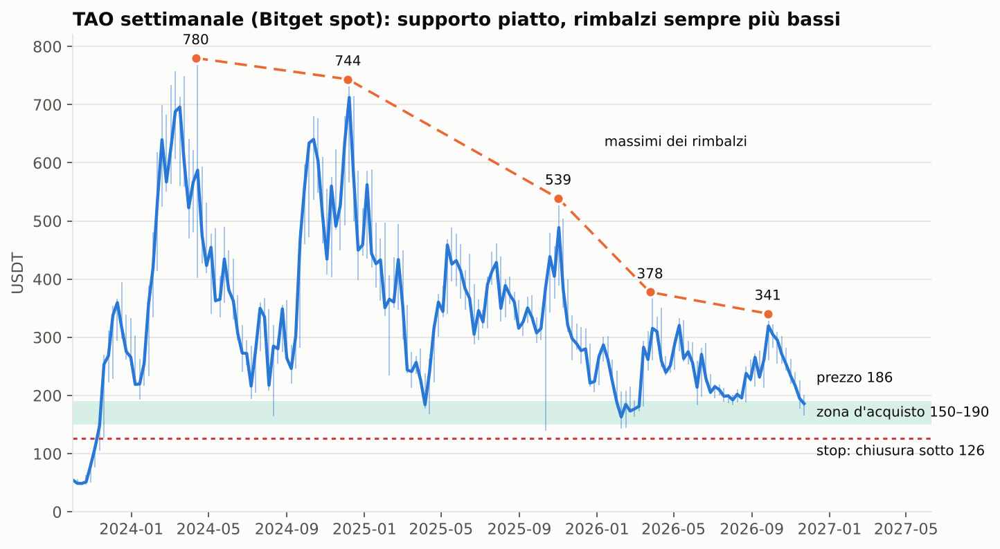

# TAO e SOL · le tue operazioni, misurate

Analisi di due modi di operare che hai usato: comprare TAO sul supporto (150–170 → 300–500) e seguire MACD e RSI su SOL
(sette operazioni long/short). Obiettivo: capire se dietro c'è una regola coerente e quando vendere. Data: 22/11/2026.
Ottica dichiarata: speculazione, nessuna posizione tenuta per convinzione, stop sotto 140–120 su TAO, spot 40–50 mila $ più
2–3 mila $ a leva su Bitget.

> Ricerca su dati storici, non una raccomandazione d'investimento.

## 1. Sintesi

**Le due regole hanno funzionato su TAO e su SOL, ma nessuna delle due regge sulle altre monete: non sono un algoritmo
generale. Il tuo vantaggio, per quanto si vede dai dati, sta nella scelta di quali segnali prendere, non nel segnale.**

1. **SOL: i tuoi sette trade sono l'incrocio del MACD settimanale.** La regola meccanica entra e esce quasi ai tuoi stessi
   prezzi. Però la regola fa 15 trade, tu ne hai fatti 7: hai saltato 8 segnali, di cui 6 in perdita. Senza costi la regola
   fa x3,3, i tuoi sette trade x52.
2. **La stessa regola altrove perde.** Su TAO porta il capitale a un decimo. Su 161 altcoin dal 2021 guadagna nel 23% dei
   casi, con capitale finale mediano x0,20. Nessuna variante con RSI o stop supera il 42% di monete in guadagno.
3. **TAO: comprare sul supporto testato non dà vantaggio sulle altre alt.** Su 947 eventi di 165 monete il prezzo arriva a
   +30% prima dello stop nel 44% dei casi; con ingressi in giorni casuali nel 45%. TAO è un'eccezione: 5 eventi su 7 a +50%.
4. **Quando vendere**: nessuna regola di uscita è la migliore in entrambi i periodi. Sul campione ampio i target fissi sono
   i peggiori e le uscite che lasciano correre (trailing, media mobile) le migliori in media; su TAO, che si muove in un
   intervallo, è stato il contrario. I rimbalzi si accorciano: il massimo successivo è in mediana il 67% del precedente.
5. **Oggi i tuoi due metodi su TAO sono in disaccordo**: il prezzo è nella zona d'acquisto, ma il MACD settimanale è sotto
   la linea di segnale (la regola è short da 217 $ dal 09/11).
6. **Leva**: con stop a 126 $ da un ingresso a 170 $ la leva massima sensata è 3x. Il 10/10/2025 il perp TAO su Bitget è
   sceso del 62% in giornata: un long a leva aperto più in alto sarebbe stato liquidato prima della chiusura.



## 2. SOL: i tuoi trade contro la regola

Regola: long quando il MACD (12, 26, 9) settimanale è sopra la linea di segnale, short quando è sotto; si opera alla chiusura
della settimana. Dati Binance SOLUSDT fino al 10/2026.

| Regola: incrocio MACD settimanale | Entra | Esce | Prezzi della regola | Mossa regola | Tuo trade | Tua mossa |
|---|---|---|---|---|---|---|
| Long | 2021-06-01 | 2021-06-28 | 33 → 32 | -3% | **non fatto** | – |
| Short | 2021-06-28 | 2021-08-16 | 32 → 54 | -68% | **non fatto** | – |
| Long | 2021-08-16 | 2021-12-13 | 54 → 173 | +223% | **non fatto** | – |
| Short | 2021-12-13 | 2022-08-01 | 173 → 42 | +75% | Short 180 → 30 | +83% |
| Long | 2022-08-01 | 2023-09-18 | 42 → 19 | -56% | **non fatto** | – |
| Short | 2023-09-18 | 2023-10-02 | 19 → 24 | -27% | **non fatto** | – |
| Long | 2023-10-02 | 2024-04-29 | 24 → 138 | +478% | Long 20 → 160 | +700% |
| Short | 2024-04-29 | 2024-10-28 | 138 → 177 | -28% | Short 160, stop a 160 | -0% |
| Long | 2024-10-28 | 2025-01-13 | 177 → 189 | +7% | Long 170 → 200 | +18% |
| Short | 2025-01-13 | 2025-01-20 | 189 → 252 | -34% | **non fatto** | – |
| Long | 2025-01-20 | 2025-02-03 | 252 → 204 | -19% | **non fatto** | – |
| Short | 2025-02-03 | 2025-05-19 | 204 → 173 | +15% | Short 200 → 95 | +52% |
| Long | 2025-05-19 | 2025-10-27 | 173 → 200 | +15% | Long 160 → 200 | +25% |
| Short | 2025-10-27 | 2026-04-20 | 200 → 83 | +58% | Short 200 → 80 | +60% |
| Long | 2026-04-20 | aperto | 83 → 96 | +14% | **non fatto** | – |

Composto senza costi: regola x3.3 su 15 trade; i tuoi 7 trade x52.6.

Lettura:

- **Hai preso 7 segnali su 15, tutti nello stesso verso e a prezzi vicini a quelli della regola.** Sei dei tuoi sette sono in
  guadagno e uno in pari.
- **Gli 8 segnali che non hai fatto**: sei in perdita (−68%, −56%, −34%, −27%, −19%, −3%) e due in guadagno (+223% nel 2021 e
  il long aperto ad aprile 2026). È questa selezione che separa x52 da x3,3.
- **Sei uscito meglio della regola negli short**: 200 → 95 contro 204 → 173, e 160 in pari contro −28%.

Non posso ricostruire dai soli sette trade il criterio con cui hai scartato gli altri: è la prima cosa che ti chiedo al
capitolo 8. Senza quel criterio, la regola meccanica da sola non è il tuo metodo.

## 3. La regola MACD/RSI sulle altre monete

Stesse regole, stessi parametri, a 1x sul perp, costi 0,11% per lato e funding 0,01% ogni 8 ore. SOL, BTC ed ETH dal 06/2021,
TAO dal 06/2024.

| Regola (settimanale, 1x) | SOL | DD | Trade / vincenti | TAO | DD | BTC | DD | ETH | DD |
|---|---|---|---|---|---|---|---|---|---|
| MACD incrocio | x3.3 (+25%/anno) | -88% | 15 / 53% | x0.1 (-64%/anno) | -96% | x0.9 (-1%/anno) | -59% | x1.6 (+9%/anno) | -68% |
| MACD + RSI 50 | x7.7 (+46%/anno) | -75% | 20 / 50% | x0.0 (-75%/anno) | -98% | x1.4 (+7%/anno) | -44% | x1.0 (-0%/anno) | -66% |
| MACD + RSI 50, mantiene | x11.6 (+57%/anno) | -79% | 13 / 62% | x0.1 (-69%/anno) | -97% | x0.7 (-6%/anno) | -55% | x1.1 (+1%/anno) | -60% |
| MACD + uscita RSI estremo | x0.6 (-8%/anno) | -91% | 14 / 57% | x0.1 (-64%/anno) | -96% | x0.8 (-4%/anno) | -55% | x2.5 (+18%/anno) | -59% |
| MACD sopra/sotto zero | x7.7 (+46%/anno) | -69% | 11 / 55% | x0.0 (-73%/anno) | -97% | x1.5 (+8%/anno) | -58% | x0.8 (-4%/anno) | -70% |
| RSI 55/45 | x1.8 (+12%/anno) | -91% | 9 / 44% | x0.0 (-88%/anno) | -100% | x1.0 (-0%/anno) | -58% | x0.2 (-24%/anno) | -87% |
| Solo long MACD + RSI 50 | x7.9 (+47%/anno) | -61% | 11 / 55% | x0.2 (-48%/anno) | -87% | x2.0 (+14%/anno) | -38% | x1.8 (+12%/anno) | -43% |
| MACD incrocio, stop 15% | x9.0 (+50%/anno) | -70% | 15 / 40% | x0.1 (-55%/anno) | -93% | x0.5 (-11%/anno) | -65% | x1.2 (+3%/anno) | -66% |
| MACD incrocio, stop 25% | x6.6 (+42%/anno) | -82% | 15 / 47% | x0.1 (-62%/anno) | -95% | x0.6 (-8%/anno) | -72% | x1.2 (+4%/anno) | -69% |
| MACD + RSI 50, mantiene, stop 15% | x12.6 (+60%/anno) | -68% | 13 / 54% | x0.1 (-59%/anno) | -94% | x1.0 (-0%/anno) | -58% | x1.1 (+1%/anno) | -57% |
| MACD + RSI 50, mantiene, stop 25% | x14.0 (+63%/anno) | -75% | 13 / 62% | x0.1 (-67%/anno) | -97% | x0.8 (-4%/anno) | -54% | x1.4 (+7%/anno) | -55% |
| Comprare e tenere | x3.1 | -96% | – | x0.5 | -80% | x2.0 | -77% | x0.9 | -79% |

Su tutte le altcoin con almeno due anni di storia:

| Regola (settimanale, 1x, dal 2021 o dalla quotazione) | Monete | In guadagno | Capitale finale mediano | CAGR mediano | DD mediano | Meglio di comprare e tenere | In guadagno 2021–23 | In guadagno 2024–26 |
|---|---|---|---|---|---|---|---|---|
| MACD incrocio | 161 | 23% | x0.20 | -33% | -96% | 57% | 28% | 32% |
| MACD + RSI 50 | 161 | 34% | x0.52 | -16% | -90% | 70% | 37% | 33% |
| MACD + RSI 50, mantiene | 161 | 25% | x0.39 | -22% | -91% | 66% | 32% | 30% |
| MACD + uscita RSI estremo | 161 | 22% | x0.25 | -27% | -94% | 60% | 22% | 34% |
| MACD sopra/sotto zero | 161 | 32% | x0.67 | -10% | -88% | 71% | 41% | 27% |
| RSI 55/45 | 161 | 16% | x0.13 | -37% | -98% | 42% | 24% | 17% |
| Solo long MACD + RSI 50 | 161 | 30% | x0.63 | -13% | -78% | 85% | 51% | 16% |
| MACD incrocio, stop 15% | 161 | 39% | x0.73 | -10% | -84% | 76% | 36% | 38% |
| MACD incrocio, stop 25% | 161 | 30% | x0.60 | -15% | -90% | 71% | 36% | 36% |
| MACD + RSI 50, mantiene, stop 15% | 161 | 42% | x0.77 | -5% | -80% | 77% | 39% | 46% |
| MACD + RSI 50, mantiene, stop 25% | 161 | 38% | x0.69 | -10% | -86% | 75% | 41% | 36% |
| Comprare e tenere | 161 | 13% | x0.13 | – | -97% | – | – | – |

- **SOL è il caso migliore, non il caso tipico.** Su SOL quasi ogni variante guadagna; su TAO, BTC ed ETH quasi nessuna.
- **Lo stop al 15% è l'unica modifica che migliora in modo costante**: le monete in guadagno passano dal 23% al 39–42%. Resta
  una regola in perdita sulla moneta mediana.
- Le regole long/short battono il "comprare e tenere" nel 57–85% delle monete solo perché tenere le altcoin dal 2021 è andato
  peggio (mediana x0,13): è un confronto con un'alternativa pessima, non un guadagno.
- È lo stesso esito che il tuo repo radar aveva già trovato su BTC, ETH e SOL (MACD settimanale, "non adottato").

Stato attuale della regola (ultima settimana chiusa nei dati):

| Moneta | Ultima candela settimanale chiusa | MACD rispetto al segnale | RSI settimanale | Posizione della regola | Dal |
|---|---|---|---|---|---|
| SOL | 2026-10-25 a 101 | sopra | 52 | long da 83 | 2026-04-20 |
| TAO | 2026-11-15 a 195 | sotto | 42 | short da 217 | 2026-11-09 |
| BTC | 2026-11-08 a 74,851 | sopra | 48 | long da 65,400 | 2026-07-27 |
| ETH | 2026-10-25 a 2,330 | sopra | 50 | long da 1,807 | 2026-07-13 |

## 4. TAO: il supporto testato, misurato su 165 monete

Ho tradotto il tuo schema in una definizione uguale per tutte le monete: un minimo settimanale da cui il prezzo è risalito
di almeno il 60%; quando il prezzo ci torna, acquisto limite al 5% sopra quel livello; stop su chiusura giornaliera il 12%
sotto il minimo più basso della zona (per TAO: 126 $, dentro il tuo intervallo 140–120). Per TAO lo storico è Bitget spot dal
03/2023; per le altre l'archivio Binance, con le monete poi crollate o delistate (LUNA, FTT, SRM e simili) incluse.

| Gruppo | Eventi | Monete | Arriva a +30% | a +50% | a +100% | a +200% | Stop entro 2 anni | Mai +30% | Massimo mediano | Calo mediano prima |
|---|---|---|---|---|---|---|---|---|---|---|
| Tutte le alt, 2019–10/2025 | 947 | 165 | 44% | 33% | 22% | 11% | 93% | 56% | +25% | -28% |
| 2019–2022 | 379 | 114 | 32% | 23% | 17% | 12% | 93% | 68% | +17% | -26% |
| 2023–10/2025 | 568 | 153 | 52% | 40% | 25% | 10% | 94% | 48% | +33% | -31% |
| BTC sopra la media a 200 giorni | 526 | 155 | 45% | 32% | 18% | 9% | 94% | 55% | +26% | -31% |
| BTC sotto la media a 200 giorni | 410 | 130 | 44% | 37% | 27% | 13% | 92% | 56% | +25% | -27% |
| 2° tocco | 496 | 164 | 40% | 30% | 21% | 10% | 96% | 60% | +22% | -25% |
| 3° tocco | 254 | 130 | 48% | 36% | 25% | 13% | 89% | 52% | +27% | -30% |
| 4° tocco | 108 | 72 | 53% | 44% | 26% | 10% | 94% | 47% | +37% | -33% |
| 5° tocco o oltre | 89 | 60 | 49% | 33% | 17% | 8% | 94% | 51% | +29% | -35% |
| TAO (Bitget, tutti gli eventi) | 7 | 1 | 71% | 71% | 57% | 29% | 57% | 29% | +137% | -25% |
| Ingressi casuali, stesse monete e stesso stop | 18920 | 165 | 45% | 35% | 24% | 13% | 92% | 55% | +23% | – |

"Arriva a +X%" = il prezzo tocca quel guadagno prima che scatti lo stop. L'ultima riga usa le stesse monete e la stessa
distanza dello stop, ma con ingressi in giorni scelti a caso.

- **Il supporto non aggiunge nulla al caso**: 44% contro 45% a +30%, 33% contro 35% a +50%.
- **Il numero di tocchi non peggiora le probabilità**: al terzo e quarto tocco sono leggermente migliori che al secondo, e
  tornano nella media dal quinto in poi. TAO oggi è al sesto.
- **Il regime di BTC non cambia il risultato.**
- **TAO è molto sopra la media** (71% a +50% su 7 eventi), ma sette eventi su una moneta scelta perché ha funzionato non
  sono una prova.

Su 782 coppie di visite consecutive alla stessa moneta, il massimo del rimbalzo successivo è stato in mediana il 67% del massimo precedente; nel 73% dei casi è stato più basso, nel 53% sotto il 70%.

Per TAO: il massimo precedente è 341 $. Il 67% di 341 è circa 230 $; i massimi di TAO finora sono scesi al 95%, 72%, 70% e
90% del precedente, cioè fra 240 e 325 $ se il passo resta quello.

## 5. Quando vendere

Stessi ingressi e stesso stop, 19 regole di uscita. La colonna da guardare è il rendimento per 100 giorni di capitale
impegnato, perché tu ragioni per opportunità e il capitale fermo ha un costo.

**Tutte le alt, eventi 2019–10/2025** (ordinate per rendimento per 100 giorni di capitale impegnato)

| Regola di vendita | Rendimento medio | Mediano | Vincenti | Peggiore | Giorni medi | Rendimento medio per 100 giorni | Media 2019–22 | Media 2023–25 |
|---|---|---|---|---|---|---|---|---|
| chandelier 3 ATR (dal +30%) | +10,5% | -18,0% | 36% | -68% | 42 | +24,9% | +23,2% | +2,0% |
| uscita a 180 giorni | +14,8% | -20,4% | 19% | -68% | 72 | +20,5% | +37,7% | -0,5% |
| uscita a 90 giorni | +8,6% | -18,8% | 29% | -68% | 49 | +17,6% | +24,4% | -2,0% |
| trailing 35% (dal +30%) | +11,0% | -18,7% | 25% | -68% | 64 | +17,2% | +21,0% | +4,3% |
| chiusura sotto SMA50 (dal +30%) | +5,3% | -18,0% | 40% | -68% | 36 | +14,9% | +7,1% | +4,2% |
| meta' a +50%, meta' trailing 30% | +5,1% | -18,1% | 33% | -68% | 47 | +10,8% | +4,8% | +5,2% |
| trailing 25% (dal +30%) | +4,6% | -18,0% | 33% | -68% | 46 | +9,9% | +4,2% | +4,8% |
| solo stop (tenere 2 anni) | +10,6% | -21,7% | 6% | -68% | 129 | +8,2% | +31,2% | -3,2% |
| target +100% | +3,3% | -20,2% | 22% | -68% | 58 | +5,6% | -2,6% | +7,2% |
| RSI settimanale > 70 | +4,0% | -21,0% | 13% | -68% | 78 | +5,1% | +9,6% | +0,3% |
| meta' a +50%, meta' a +100% | +2,0% | -18,9% | 33% | -68% | 48 | +4,2% | -4,6% | +6,5% |
| terzi a +30/+60/+100% | +1,5% | -17,4% | 30% | -68% | 43 | +3,5% | -5,0% | +5,8% |
| RSI giornaliero > 80 | +2,3% | -20,7% | 17% | -68% | 68 | +3,4% | +3,9% | +1,2% |
| target +150% | +2,1% | -20,9% | 15% | -68% | 72 | +2,9% | -1,7% | +4,7% |
| target +75% | +1,3% | -19,8% | 26% | -68% | 51 | +2,6% | -5,7% | +6,0% |
| target +50% | +0,8% | -18,9% | 33% | -68% | 39 | +2,0% | -6,6% | +5,7% |
| 70% del massimo precedente | +0,8% | -18,5% | 37% | -68% | 40 | +1,9% | -2,8% | +3,1% |
| target +200% | +0,9% | -21,2% | 11% | -68% | 81 | +1,1% | +3,5% | -0,8% |
| target +30% | -0,0% | -17,4% | 44% | -68% | 25 | -0,1% | -6,9% | +4,5% |

**Solo dal 3° tocco in poi** (la situazione di TAO oggi)

| Regola di vendita | Rendimento medio | Mediano | Vincenti | Peggiore | Giorni medi | Rendimento medio per 100 giorni | Media 2019–22 | Media 2023–25 |
|---|---|---|---|---|---|---|---|---|
| chiusura sotto SMA50 (dal +30%) | +7,1% | -19,2% | 45% | -68% | 41 | +17,3% | +18,0% | +4,0% |
| uscita a 90 giorni | +7,1% | -20,4% | 32% | -68% | 55 | +12,8% | +45,4% | -4,0% |
| trailing 25% (dal +30%) | +5,9% | -19,2% | 37% | -68% | 55 | +10,9% | +7,2% | +5,6% |
| chandelier 3 ATR (dal +30%) | +4,7% | -19,2% | 41% | -68% | 48 | +9,9% | +14,6% | +1,9% |
| uscita a 180 giorni | +8,1% | -22,7% | 22% | -68% | 83 | +9,8% | +38,7% | -0,7% |
| trailing 35% (dal +30%) | +6,1% | -20,0% | 27% | -68% | 75 | +8,2% | +12,4% | +4,3% |
| meta' a +50%, meta' trailing 30% | +4,2% | -19,4% | 37% | -68% | 56 | +7,4% | +2,0% | +4,8% |
| solo stop (tenere 2 anni) | +11,2% | -24,2% | 8% | -68% | 151 | +7,4% | +33,2% | +4,8% |
| RSI giornaliero > 80 | +3,8% | -23,2% | 20% | -68% | 80 | +4,8% | +11,8% | +1,5% |
| target +100% | +3,5% | -22,7% | 24% | -68% | 72 | +4,8% | -2,7% | +5,2% |
| meta' a +50%, meta' a +100% | +2,8% | -20,7% | 37% | -68% | 60 | +4,6% | -4,7% | +4,9% |
| target +30% | +1,3% | -17,4% | 49% | -68% | 29 | +4,5% | -10,1% | +4,6% |
| terzi a +30/+60/+100% | +2,3% | -17,4% | 33% | -68% | 52 | +4,5% | -6,2% | +4,8% |
| RSI settimanale > 70 | +4,0% | -23,5% | 15% | -68% | 91 | +4,4% | +13,1% | +1,4% |
| target +50% | +2,1% | -20,7% | 37% | -68% | 48 | +4,3% | -6,8% | +4,6% |
| target +150% | +2,8% | -23,4% | 16% | -68% | 86 | +3,2% | +1,7% | +3,1% |
| target +75% | +1,8% | -22,4% | 28% | -68% | 64 | +2,9% | -7,6% | +4,6% |
| 70% del massimo precedente | +0,3% | -20,6% | 39% | -68% | 51 | +0,5% | -3,6% | +1,4% |
| target +200% | +0,1% | -23,8% | 12% | -68% | 99 | +0,1% | +7,5% | -2,0% |

Sui soli eventi di TAO (pochi, da leggere come esempio):

| Ingresso | Prezzo | Stop | Tocco | Massimo dopo | +50% | +100% | 70% max prec. | trailing 25% | metà +50% / metà trailing | terzi +30/+60/+100 |
|---|---|---|---|---|---|---|---|---|---|---|
| 2024-07-05 | 203 | 170 | 2 | +266% | +50% | +100% | +168% | +30% | +28% | +63% |
| 2024-08-05 | 203 | 170 | 2 | +266% | +50% | +100% | +168% | +22% | +33% | +63% |
| 2025-04-06 | 187 | 144 | 3 | +188% | +50% | +100% | +177% | +81% | +59% | +63% |
| 2025-09-22 | 302 | 253 | 2 | +79% | +50% | -21% | +10% | +22% | +31% | +23% |
| 2025-11-20 | 302 | 253 | 2 | +7% | -21% | -21% | -21% | -21% | -21% | -21% |
| 2026-02-05 | 159 | 123 | 3 | +137% | +50% | +100% | +136% | +61% | +50% | +63% |
| **Media** | | | | +157% | +38% | +59% | +106% | +32% | +30% | +42% |

Conclusioni:

1. **Il risultato tipico di un singolo trade è lo stop**: il rendimento mediano è intorno a −18/−20% con qualunque uscita, e i
   vincenti sono il 25–45%. Il rendimento medio positivo viene da pochi trade molto grandi.
2. **I target fissi tagliano proprio quei pochi trade grandi**: sul campione ampio sono in fondo alla classifica; il target
   +30% ha rendimento medio zero.
3. **Le uscite che lasciano correre sono le migliori in media**: trailing, chandelier e media a 50 giorni sono positive in
   entrambi i periodi, mentre i target fissi sono negativi nel 2019–22. Il vantaggio però si è ridotto molto: dal 2023 tutte
   le regole stanno fra −3% e +7% per operazione.
4. **Su TAO ha vinto il target fisso** (+59% medio con target +100% contro +32% del trailing 25%), perché TAO si muove in un
   intervallo. Vale finché l'intervallo regge, e i massimi si stanno abbassando.
5. **La tua sensazione di "troppo esposto" corrisponde a una regola precisa**: vendere una parte a un target vicino al
   massimo atteso e lasciare il resto a un trailing. È la combinazione che perde meno in entrambi gli scenari.

## 6. Leva su Bitget

Funding medio del perp TAO su Bitget negli ultimi 90 giorni: +7,0% annuo pagato dai long (storico più lungo non disponibile dall'API).

| Leva (margine isolato) | Liquidazione a circa | Stop a 126 $ da ingresso 170 $ | Perdita allo stop sul margine | Guadagno a +50% sul margine | A +100% | Regge un calo del 26% (stop)? |
|---|---|---|---|---|---|---|
| 1x | -100% | -26% | -26% | +50% | +100% | sì |
| 2x | -49% | -26% | -52% | +100% | +200% | sì |
| 3x | -32% | -26% | -78% | +150% | +300% | sì |
| 5x | -19% | -26% | -100% | +250% | +500% | no: liquidato prima dello stop |
| 10x | -9% | -26% | -100% | +500% | +1000% | no: liquidato prima dello stop |

Crollo lampo del 10/10/2025 sul perp Bitget: da 347 a 133 $ in giornata (-62%), chiusura 291 $.

| Ingresso long sul perp | Prezzo | Minimo toccato dopo (prima di +50%) | Calo massimo | Liquidato a 2x? | a 3x? | a 5x? |
|---|---|---|---|---|---|---|
| 2024-07-05 | 203 | 192 | -5% | no | no | no |
| 2024-08-05 | 203 | 163 | -20% | no | no | sì |
| 2025-04-06 | 187 | 168 | -11% | no | no | no |
| 2025-09-22 | 302 | 133 | -56% | sì | sì | sì |
| 2025-11-20 | 302 | 143 | -53% | sì | sì | sì |
| 2026-02-05 | 159 | 143 | -11% | no | no | no |
| 2026-11-14 | 192 | 165 | -14% | no | no | no |

- **Fino a 3x** lo stop a 126 $ scatta prima della liquidazione; a 5x no.
- **I due ingressi liquidati nella tabella erano a 302 $**, fuori dalla tua zona, ma mostrano il rischio: il 10/10/2025 il
  prezzo ha chiuso a 291 $ dopo aver toccato 133 $. Uno stop su chiusura non protegge una posizione a leva da un minimo di
  poche ore; serve uno stop a mercato sull'exchange, che in quei momenti si esegue molto sotto il livello.
- **Dimensione**: con 2.500 $ di margine a 3x controlli 7.500 $; allo stop perdi circa 1.950 $, a +50% guadagni 3.750 $.
- Sullo spot, 45.000 $ con stop a 126 $ da 170 $ sono circa 11.700 $ di perdita se lo stop scatta.

## 7. Proposta per procedere

Non c'è una regola validata da darti. C'è un procedimento che rende le tue operazioni misurabili e limita il danno mentre si
raccolgono i dati. Tutti i livelli sono proposte da confermare.

**A · TAO, se decidi di rientrare (spot)**

| Passo | Regola |
|---|---|
| Ingresso | ordini limite a 190, 170 e 150 $, un terzo ciascuno |
| Stop | chiusura giornaliera sotto 126 $: esci da tutto |
| Prima uscita | metà posizione a 240 $ (70% del massimo precedente di 341 $) |
| Seconda uscita | l'altra metà con trailing del 25% dal massimo di chiusura, attivo da +30% |
| Rottura | con chiusura settimanale sopra 341 $ il trailing passa al 35% |
| Aspettativa | dalle probabilità di base: circa una volta su due si arriva a +30% prima dello stop. Guadagno atteso sottile: ad esempio 0,5 × (+35%) − 0,5 × (−26%) ≈ +5% per operazione |
| Conflitto | il MACD settimanale è ancora short: se vuoi coerenza con il metodo SOL, aspetta l'incrocio al rialzo |

**B · SOL e altre, metodo MACD settimanale**

| Passo | Regola |
|---|---|
| Segnale | incrocio del MACD settimanale, valutato alla chiusura della domenica |
| Filtro | il tuo criterio di selezione, da scrivere prima del prossimo segnale (capitolo 8) |
| Stop | 15% dall'ingresso su chiusura giornaliera; si rientra solo al segnale successivo |
| Monete | solo quelle su cui decidi prima; la regola non va estesa a un paniere di alt |

**C · Leva**: al massimo 3x, margine isolato, solo sulla parte da 2–3 mila $, stop a mercato sull'exchange.

**D · Registro**: ogni segnale preso o scartato va annotato con il motivo. Dopo 15–20 segnali si può misurare se il tuo
filtro vale davvero. Il repo radar ha già un registro dei trade via Telegram che si può riusare.

## 8. Domande

1. **Perché hai saltato gli 8 segnali MACD su SOL?** In particolare il long a 42 $ di agosto 2022 e i due segnali di gennaio
   2025. Guardavi l'RSI, il trend di BTC, la struttura del grafico, le notizie? È il pezzo che manca per scrivere la regola.
2. **I sette trade su SOL sono tutti quelli che hai fatto**, o ci sono operazioni in perdita, anche su altre monete, che non
   hai elencato? Per misurare il tuo vantaggio servono anche quelle.
3. **Mi puoi dare le date** di ingresso e uscita, anche approssimate? Con le date posso confrontare ogni trade con gli
   indicatori di quel momento.
4. **Come uscivi dagli short** prima della regola (95 $ invece di 173 $)? RSI in ipervenduto, un supporto, un target?
5. **Su TAO, quale dei due metodi comanda** quando sono in disaccordo, come adesso?
6. **Qual è la perdita massima in dollari** che accetti su una singola operazione? Con 45.000 $ e stop a 126 $ sono 11.700 $.
7. **Vuoi che testi il tuo filtro** su SOL e sulle altre monete, una volta che me lo descrivi?

## 9. Contesto e fonti

| Tema | Cosa dicono le fonti |
|---|---|
| Bittensor | Primo halving previsto per il 14/12/2025: emissione giornaliera da 7.200 a 3.600 TAO; offerta massima 21 milioni, circa 9,6 milioni in circolazione prima dell'halving. dTAO da febbraio 2025 rende investibili le singole subnet. Le fonti trovate sono precedenti all'halving: l'esito non è verificato. |
| Triangolo discendente | Sul sito di Bulkowski il triangolo discendente può rompere in entrambe le direzioni; le percentuali che circolano (53% al rialzo, 47% al ribasso) vengono da articoli di terzi e non le ho potute verificare sul testo. |
| Sopravvivenza delle altcoin | CoinMarketCap via Fortune (11/2026): quasi due terzi delle 100 maggiori altcoin del 2021 hanno perso oltre il 90%. Blockworks Research: l'86% dei token che avevano battuto BTC nel 2020–21 ha poi perso almeno il 90%. Coerente con la mediana x0,13 di questo studio. |
| Regole di uscita | Fonti per lo più di operatori, risultati misti: i trailing stop aiutano dove c'è momentum e peggiorano altrove; i target stretti spesso falliscono. Nessuna evidenza accademica conclusiva. |

- [The Block — Bittensor halving](https://www.theblock.co/news/ecosystems/2025-12-07-bittensors-halving-tao-price-381638) · [Cointelegraph](https://cointelegraph.com/news/crypto-other-halving-bittensor-maturation-milestone) · [Crypto.com](https://crypto.com/en/market-updates/bittensor-halving-all-you-need-to-know)
- [Bulkowski — ThePatternSite, descending triangles](https://www.thepatternsite.com/BustDescTriangles.html)
- [Fortune — altcoins lost 90%](https://fortune.com/2026/11/06/altcoins-lost-90-percent-coinmarketcap-data/) · [Blockworks Research — One in Twenty-Four](https://app.blockworksresearch.com/unlocked/one-in-twenty-four) · [CoinGecko — how many cryptocurrencies failed](https://www.coingecko.com/research/publications/how-many-cryptocurrencies-failed)
- [Interactive Brokers — Exiting your trades: what works best](https://www.interactivebrokers.com/campus/ibkr-quant-news/exiting-your-trades-what-works-best/) · [StockCharts — momentum rotation and stops](https://stockcharts.com/articles/arthurhill/2017/08/systemtrader---reworking-the-chartcon-momentum-rotation-strategy---cut-your-profits-and-dont-worry-about-stops--.html)

## 10. Limiti

- I tuoi trade su SOL sono ricostruiti dai prezzi che hai indicato, senza date: l'abbinamento ai segnali è mio.
- Le 165 altcoin sono una lista scelta da me di monete quotate su Binance, con molte monete crollate ma non tutte quelle
  esistite: la distorsione da sopravvivenza è ridotta, non eliminata.
- Gli eventi sono concentrati nelle stesse settimane di mercato: 947 eventi non sono 947 prove indipendenti.
- La definizione di "supporto" è una sola, fissata prima dei risultati; altre definizioni possono dare numeri diversi.
- Dati delle alt fino al 10/2026; TAO Bitget fino al 21/11/2026. Funding storico di TAO disponibile solo per 90 giorni.
- Stop simulati sulla chiusura giornaliera: nei crolli lampo l'esecuzione reale è peggiore.

## 11. Riproducibilità

```bash
python backtest/fetch_alts.py
```

```bash
python backtest/support_report.py
```

```bash
python backtest/macd_report.py
```

```bash
python backtest/build_report.py
```

Codice: `backtest/support_study.py` (definizione dell'evento e uscite), `backtest/macd_rsi.py` (regole MACD/RSI),
`backtest/tao_range.py`, `backtest/tao_chart.py`. Risultati in `results/tao/`: `eventi_alt.csv` (tutti gli eventi),
`uscite_alt.csv`, `macd_universo.csv`, `macd_incrocio_per_moneta.csv`.
